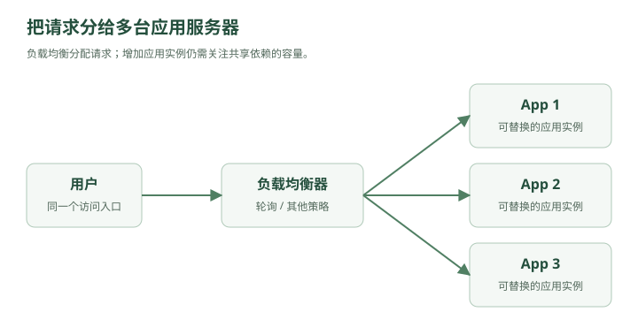

# 只有一百个人的王国

2026 年，程序员林默做了个网站。

功能极其简单：

**用户发一条动态，别人可以查看。**

类似一个极简版微博。

林默看了一眼需求：

```text
POST /posts
GET /posts/{id}
```

“这还不简单？”

于是他租了一台服务器。

服务器里面同时跑着：

```text
Nginx
  ↓
Spring Boot
  ↓
MySQL
```

甚至一开始，Nginx 都没有。

就是：

```text
用户
 ↓
Spring Boot
 ↓
MySQL
```

用户发动态：

```sql
INSERT INTO post(user_id, content)
VALUES (10001, '今天天气不错');
```

用户查看动态：

```sql
SELECT *
FROM post
WHERE id = 123;
```

网站上线。

第一天，12 个用户。

第二天，37 个用户。

一个星期以后，103 个用户。

服务器 CPU：

```text
3%
```

MySQL：

```text
毫无压力
```

林默非常满意。

他甚至产生了一种错觉：

> “系统设计不就是 CRUD 吗？”

---

## 一、第一个问题：到底什么叫“系统设计”？

三个月后，公司来了个架构师老周。

老周问：

“如果明天有 **100 万用户**呢？”

林默回答：

“换一台更好的服务器。”

“1000 万呢？”

“再换。”

“1 亿呢？”

“……”

老周笑了。

然后在白板上写下一句话：

> **系统设计，本质上是在各种约束下，让系统继续工作。**

你设计的从来不只是代码。

而是整个系统：

```text
用户
 │
 ▼
网络
 │
 ▼
服务器
 │
 ├── CPU
 ├── 内存
 ├── 磁盘
 │
 ▼
数据库
 │
 ▼
其他服务
```

任何地方都有可能成为瓶颈。

所以以后遇到系统设计题，第一件事情永远不是：

> “我要不要上 Redis？”

而是：

> **“这个系统的压力到底在哪里？”**

---

## 二、第一场灾难：服务器扛不住了

半年后。

这个网站突然火了。

某天晚上，一个明星注册了账号。

他发了一条动态。

瞬间，大量用户涌入。

服务器监控：

```text
QPS: 100
CPU: 15%

QPS: 500
CPU: 43%

QPS: 1000
CPU: 78%

QPS: 1500
CPU: 99%
```

然后——

```text
Connection timeout
Connection timeout
Connection timeout
```

网站挂了。

林默冲进机房：

“数据库炸了？”

老周摇头。

“不是。”

“那是什么？”

“Spring Boot 服务器自己扛不住了。”

---

这时候你第一次遇到系统设计里的核心指标：

## QPS

QPS：

**Queries Per Second**

在本书的 Web 场景中，用它表示每秒请求数；数据库语境中的 QPS 则通常指每秒查询数。

假设：

```text
100 万用户
```

每个用户每天请求：

```text
100 次
```

那么一天：

```text
1亿次请求
```

平均 QPS：

```text
100,000,000 / 86400
≈ 1157
```

但现实流量不会平均。

凌晨三点：

```text
200 QPS
```

晚上八点：

```text
8000 QPS
```

明星突然官宣：

```text
50000 QPS
```

所以系统设计不能只看：

> 平均 QPS。

还要看：

> **峰值 QPS。**

这就是系统设计题为什么经常先让你“估算流量”。

因为你连敌人有多少都不知道，就开始造城墙，没有意义。

---

## 三、最简单的解决方案：氪金

林默说：

“服务器性能不够，那我买台更好的。”

原服务器：

```text
4 Core
8 GB
```

换成：

```text
32 Core
128 GB
```

网站重新恢复。

这在系统设计里面叫：

### Vertical Scaling

纵向扩展。

也就是：

> **把机器变强。**

比如：

```text
4核 → 16核
16GB → 64GB
普通SSD → NVMe
```

这个方案最大的优点就是：

**简单。**

代码甚至不用改。

---

但老周问：

“如果这台机器也满了呢？”

林默：

“买 128 核。”

“再满呢？”

“……”

问题出现了。

单台机器不可能无限增强。

而且还有一个更恐怖的问题。

老周走到服务器旁边。

啪。

拔掉电源。

整个网站：

```text
DOWN
```

林默：

“？？？”

老周说：

> “你这个系统现在有一个致命问题。”

### 单点故障

Single Point of Failure。

你的整个网站依赖这一台服务器。

它挂：

```text
整个系统挂
```

硬盘坏：

```text
整个系统挂
```

机房断电：

```text
整个系统挂
```

升级重启：

```text
整个系统挂
```

所以，真正的大型系统不会只想着：

> **把一台机器变得越来越强。**

而会开始考虑：

> **能不能增加机器？**

---

## 四、第二台服务器出现了

第二天。

林默又买了一台服务器。

现在：

```text
Server A
Server B
```

两台服务器都部署：

```text
Spring Boot
```

林默非常满意。

“现在有机会分担更多请求。”

老周问：

“用户请求发给谁？”

林默沉默了。

假设：

```text
www.example.com
```

用户访问这个域名。

到底进入：

```text
Server A
```

还是：

```text
Server B
```

？

于是，系统里出现了一个新的角色。

---

## 五、负载均衡器登场

老周在两台服务器前面放了一台机器。



<details class="original-diagram" markdown="1">
<summary>查看文字版示意</summary>

```text
             ┌→ Server A
用户 → LB ───┤
             └→ Server B
```

</details>

LB：

### Load Balancer

负载均衡器。

它负责：

> **把请求分配给不同服务器。**

比如：

```text
请求1 → A
请求2 → B
请求3 → A
请求4 → B
```

最简单的算法：

### Round Robin

轮询。

```text
A → B → C → A → B → C
```

于是：

```text
原来：

10000 QPS
   ↓
Server A

现在：

10000 QPS
   ↓
Load Balancer
   ↓
 ┌─────┴─────┐
5000        5000
 ↓             ↓
A              B
```

压力被分散。实际吞吐提升还取决于数据库、网络、负载均衡器和请求分布，并不保证随机器数量线性增长。

如果还不够？

继续加：

```text
          Load Balancer
               │
      ┌────────┼────────┐
      ▼        ▼        ▼
   Server A Server B Server C
```

再不够：

```text
A B C D E F G H ...
```

这就叫：

### Horizontal Scaling

水平扩展。

不是：

> 把一台服务器变成超级赛亚人。

而是：

> **增加服务器数量。**

---

## 六、这里藏着系统设计的第一条大规律

林默盯着架构图：

```text
                    ┌── App 1
Client → LB ────────┼── App 2
                    ├── App 3
                    └── App 4
```

突然意识到一个问题。

“所以以后服务器不够，我就一直加机器？”

老周说：

“如果你的服务可以水平扩展，是的。”

这句话非常重要。

因为后面的：

```text
负载均衡
Redis Cluster
MySQL 分库分表
Kafka Partition
Elasticsearch Shard
对象存储
CDN
```

背后其实反复在做同一件事：

> **一台机器扛不住，就想办法把工作拆给很多机器。**

这几乎是整个分布式系统的起点。

---

## 七、可是第三场灾难马上来了

林默觉得自己已经懂系统设计了。

现在架构：

```text
                 ┌→ Server A
用户 → Nginx ────┤
                 └→ Server B
                       │
                       ▼
                     MySQL
```

Server A 和 Server B 都可以处理登录。

某天，一个用户登录。

请求被负载均衡发给：

```text
Server A
```

Server A 创建 Session：

```text
sessionId = abc123

abc123 → userId 9527
```

存在哪里？

服务器 A 的内存。

下一秒。

用户请求：

```text
GET /profile
```

负载均衡：

```text
→ Server B
```

Server B 查自己的内存：

```text
abc123？
```

没有。

于是返回：

```text
401 Unauthorized
```

用户：

“我刚登录怎么又让我登录？？？”

刷新一下。

请求到了 A。

登录了。

再刷新。

到了 B。

又掉登录。

于是出现了极其魔幻的现象：

```text
刷新一次：已登录
刷新一次：未登录
刷新一次：已登录
刷新一次：未登录
```

林默看傻了。

---

老周在白板写下：

> **当你从一台服务器变成多台服务器以后，很多原本理所当然的事情都会失效。**

因为以前：

```text
服务器 = 世界
```

现在：

```text
服务器 A 的内存
≠
服务器 B 的内存
```

这就是分布式系统真正开始的地方。

林默问：

“那 Session 怎么办？”

老周写出了三个方案：

```text
方案一：Sticky Session
方案二：Session Replication
方案三：共享 Session
```

然后，在第三个方案下面写了一个名字：

```text
Redis
```

林默愣了一下。

“Redis？”

老周点头。

> “从下一章开始，你会发现系统设计里几乎所有中间件的出现，都不是因为架构师喜欢炫技。”

> **而是系统先出了问题，然后才有人发明东西解决它。**

---

## 第一章结束：你现在只需要记住一张图

```text
阶段 1：

User
 ↓
App
 ↓
MySQL

阶段 2：单机性能不足

User
 ↓
更强的 App

Vertical Scaling

阶段 3：单机存在极限

              ┌→ App
User → LB ────┼→ App
              └→ App

Horizontal Scaling

阶段 4：分布式问题出现

App A memory ≠ App B memory

        ↓

状态共享问题
```

这实际上已经串起了几个面试高频概念：

**QPS → 峰值流量 → 单点故障 → 垂直扩展 → 水平扩展 → 负载均衡 → 无状态服务 → 分布式状态问题。**

下一章可以顺着这个事故继续：**《消失的登录状态——Redis 为什么会出现在系统架构里》**。

之后这条故事线会自然把 **Redis 缓存 → 缓存穿透/击穿/雪崩 → MySQL 主从 → 读写分离 → 分库分表 → MQ 削峰 → 限流/熔断/降级 → CDN → 一致性 → CAP → 分布式事务** 一路串起来。
