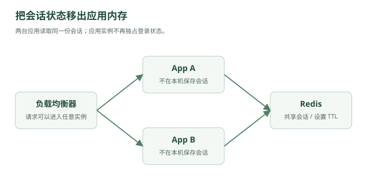

# 消失的登录状态——Redis 为什么会出现

林默原本以为，加了负载均衡之后，系统终于稳定了。

现在架构是：

```text
                ┌→ App A
用户 → Nginx ───┤
                └→ App B
                      │
                      ▼
                    MySQL
```

直到用户开始疯狂投诉：

> “为什么我一会儿登录，一会儿又掉线？”

林默一查日志，发现问题正是上一章留下的那个坑。

用户第一次登录：

```text
请求 → App A
```

于是：

```text
App A 内存：

session_123 → user_9527
```

下一次请求却被 Nginx 发给：

```text
App B
```

App B 一查：

```text
session_123？
```

不存在。

于是：

```text
401 Unauthorized
```

---

## 一、最简单的办法：你以后一直去 A

林默想了个办法。

“既然 Session 在 A，那这个用户之后的请求都发给 A 不就行了？”

老周点点头：

“可以。”

这叫：

### Sticky Session

粘性会话。

比如负载均衡器记录：

```text
user1 → App A
user2 → App B
user3 → App A
```

以后 user1 的请求始终：

```text
→ App A
```

看起来解决了。

但老周问：

“App A 挂了呢？”

林默：

“……”

App A 一挂：

```text
user1 的 Session
一起没了
```

而且可能出现：

```text
App A：1万个用户
App B：100个用户
```

负载严重不均。

所以 Sticky Session 能用，但不是特别优雅。

---

## 二、第二种方案：大家复制一份

林默又想：

“那 A 有 Session 后，复制给 B。”

于是：

```text
App A
  │
  ├── session123
  │
  ▼
复制
  │
  ▼
App B
```

如果有三台机器：

```text
A → B
A → C
```

那么大家都有：

```text
session123 → user9527
```

这叫：

### Session Replication

Session 复制。

但用户越来越多以后：

```text
10万 Session
100万 Session
1000万 Session
```

每创建一个 Session：

```text
A → B
A → C
A → D
A → E
```

大量网络同步。

如果有 100 台服务器呢？

林默脑补了一下：

```text
一个 Session
复制 99 次
```

“这是不是有点蠢？”

老周：

“开始有架构师的味道了。”

---

## 三、第三种方案：把状态搬出去

老周重新画了一张图。



<details class="original-diagram" markdown="1">
<summary>查看文字版示意</summary>

```text
                 ┌→ App A ─┐
用户 → LB ───────┤          │
                 └→ App B ─┤
                            ▼
                         Redis
```

</details>

App A 和 App B：

**都不保存 Session。**

它们统一访问 Redis。

登录时：

```text
SET session:123 user:9527
```

下一次请求到 A：

```text
GET session:123
```

下一次请求到 B：

```text
GET session:123
```

在 Redis 可用且会话未过期的前提下，两台应用能够查询同一份会话状态。

林默眼睛一亮：

> “所以 Session 不属于某一台服务器了。”

“对。”

这就是大型系统里一个非常重要的思想：

### 无状态服务

Stateless Service。

---

## 四、什么叫无状态？

假设 App A 收到请求。

如果处理这个请求需要的信息都在：

```text
请求本身
+
共享存储
```

而不是：

```text
App A 自己的内存
```

那么这个 App 就可以认为是无状态的。

于是：

```text
请求1 → A
请求2 → B
请求3 → C
```

都无所谓。

这件事极其重要。

因为只有无状态，你才可以非常轻松地：

```text
2台服务器
↓
10台
↓
100台
↓
1000台
```

服务器不够？

加。

服务器坏了？

删。

服务器升级？

替换。

不需要担心：

> “用户数据是不是存在某一台机器里？”

所以你以后看到 Kubernetes、容器、自动扩缩容时，会发现一个共同前提：

> **应用服务最好无状态。**

---

## 五、Redis 第一次正式进入系统

林默开始研究 Redis。

然后发现一个奇怪的事情。

Redis 数据主要放在：

```text
内存
```

而 MySQL 数据主要放在：

```text
磁盘
```

林默问：

“为什么 Session 不直接放 MySQL？”

当然可以。

比如：

```sql
SELECT user_id
FROM session
WHERE session_id = '123';
```

但是问题在于：

每个请求都需要认证。

假设：

```text
10000 QPS
```

意味着可能：

```text
每秒 10000 次 Session 查询
```

这些请求全部打到 MySQL。

而 Session 查询本身又非常简单：

```text
key → value
```

例如：

```text
session:123
    ↓
user:9527
```

并不需要复杂 SQL。

所以用一个擅长：

```text
高频
简单
Key-Value
内存访问
```

的系统更合适。

Redis 就很适合这种工作。

---

## 六、Redis 不只是拿来存 Session

几周后。

另一个事故来了。

首页有一个接口：

```text
GET /user/9527
```

查询：

```sql
SELECT *
FROM user
WHERE id = 9527;
```

平时没什么问题。

但是某个大主播火了。

100 万人疯狂打开他的主页。

数据库里不断执行：

```sql
SELECT *
FROM user
WHERE id = 9527;

SELECT *
FROM user
WHERE id = 9527;

SELECT *
FROM user
WHERE id = 9527;

SELECT *
FROM user
WHERE id = 9527;
```

数据每次都完全一样。

林默看着 MySQL CPU：

```text
92%
95%
97%
```

突然感觉哪里不对。

“100 万个人查同一个东西，我为什么要让 MySQL 查 100 万次？”

老周：

“终于问到缓存真正的核心问题了。”

---

## 七、缓存出现

第一次查询：

```text
用户
 ↓
Redis
 ↓
没有
 ↓
MySQL
 ↓
查到数据
 ↓
写入 Redis
```

Redis：

```text
user:9527
=
{
  name: "林某某",
  avatar: "...",
  followers: 10000000
}
```

之后：

```text
用户
 ↓
Redis
 ↓
直接返回
```

于是原来：

```text
10000 QPS
全部 → MySQL
```

变成：

```text
10000 QPS
   │
   ├── 9900 → Redis
   │
   └── 100 → MySQL
```

数据库压力瞬间下降。

林默第一次真正理解：

> **Redis 最核心的价值之一，不是“快”这么简单。**

而是：

> **替后面的慢系统挡请求。**

---

## 八、缓存的本质

老周问：

“为什么 Redis 可以做缓存？”

林默说：

“因为它快。”

“还不完整。”

老周画：

```text
CPU Cache
   ↓
内存
   ↓
SSD
   ↓
机械硬盘
   ↓
远程服务
```

计算机系统里大量设计都有同一个规律：

> **把常用的数据放到离使用者更近、更快的地方。**

比如 CPU：

```text
寄存器
L1
L2
L3
内存
磁盘
```

Web 系统也是：

```text
浏览器缓存
 ↓
CDN
 ↓
Nginx
 ↓
Redis
 ↓
MySQL
```

这和内存层级的思路相似：尽量把热门数据放在离使用者更近的位置。不过，浏览器、CDN、Redis 与数据库的延迟、容量和成本取决于实际部署，不能直接套用 CPU 缓存的价格与容量关系。

所以缓存不是 Redis 专属概念。

Redis 只是：

> **分布式系统里非常常见的一层缓存。**

---

## 九、Cache Aside

林默于是写出了经典代码。

查询：

```java
User user = redis.get("user:" + id);

if (user == null) {
    user = mysql.selectUser(id);
    redis.set("user:" + id, user);
}

return user;
```

这叫：

### Cache Aside Pattern

旁路缓存。

流程：

```text
读：

先 Redis
   ↓
有 → 返回

没有
 ↓
查 DB
 ↓
写 Redis
 ↓
返回
```

这是面试中最常见的缓存模式之一。

林默觉得：

“这也不难。”

老周看了他一眼。

“系统设计里最危险的时刻，就是你觉得问题解决了的时候。”

---

## 十、一个不存在的用户

某天有人恶意请求：

```text
GET /user/999999999
```

数据库中根本没有这个用户。

流程：

```text
Redis
 ↓
没有
 ↓
MySQL
 ↓
也没有
```

下一次：

```text
Redis
 ↓
还是没有
 ↓
MySQL
```

因为：

```text
不存在的数据
没有被缓存
```

攻击者开始不断随机请求：

```text
/user/111111111
/user/222222222
/user/333333333
...
```

Redis 全部 Miss。

请求全部穿过去：

```text
攻击者
  ↓
Redis
  ↓
Redis 没有
  ↓
MySQL
```

Redis 仿佛不存在一样。

数据库开始冒烟。

老周在白板写下四个字：

### 缓存穿透

Cache Penetration。

核心特点：

> **请求的数据，缓存没有，数据库也没有。**

所以每一次请求都会穿过缓存。

---

## 十一、怎么解决缓存穿透？

最简单的方法：

即使没查到，也缓存。

比如：

```text
user:99999999 → NULL
```

设置一个较短 TTL：

```text
60 秒
```

于是：

第一次：

```text
Redis Miss
↓
DB Miss
↓
Redis 写 NULL
```

后面请求：

```text
Redis Hit(NULL)
```

不用继续打 DB。

这叫：

### 缓存空值

但是如果攻击者每次随机生成新 ID：

```text
111
222
333
444
...
```

还是没用。

于是另一个东西出现：

### Bloom Filter

布隆过滤器。

---

## 十二、城门口的名单

你可以把 Bloom Filter 想象成：

> 数据库城堡外面的门卫。

数据库中现有：

```text
user1
user2
user3
...
user1000000
```

门卫拿着一份特殊名单。

请求：

```text
user9527
```

门卫检查：

```text
“可能存在。”
```

放进去。

请求：

```text
user999999999999
```

门卫：

```text
“一定不存在。”
```

直接拒绝。

于是：

```text
请求
 ↓
Bloom Filter
 ↓
一定不存在 → 返回
 ↓
可能存在
 ↓
Redis
 ↓
MySQL
```

为什么叫“可能存在”？

因为布隆过滤器有一个特点：

```text
它说不存在
→ 一定不存在

它说存在
→ 可能存在
```

存在一定概率误判。

但用很小的空间，可以表示海量数据。

> **工程补充**：“一定不存在”针对的是已经加入且未被错误删除的集合。若新增记录还没同步到过滤器，就可能误挡真实数据；需要设计更新顺序、故障回退和重建机制。缓存空值也应使用可区分的占位值，并设置短 TTL。

---

## 十三、第二场缓存灾难

某天，一个明星发动态。

他的用户信息正好缓存在 Redis：

```text
user:9527
```

TTL：

```text
3600 秒
```

晚上 8 点整。

这个 Key 过期了。

与此同时：

```text
10 万用户
```

刚好一起刷新他的主页。

瞬间：

```text
100000 请求
 ↓
Redis
 ↓
全部 Miss
 ↓
MySQL
```

数据库：

```text
？？？？？
```

刚才缓存还帮数据库挡住所有请求。

结果 Key 一过期：

> 所有请求瞬间打穿。

老周写：

### 缓存击穿

Cache Breakdown / Hot Key Expiration。

核心：

> **某一个热点 Key 失效，大量请求同时访问数据库。**

注意和穿透不同。

穿透：

```text
数据本来就不存在
```

击穿：

```text
数据存在
而且特别热
但缓存突然失效
```

---

## 十四、互斥锁

解决思路之一：

当 Redis Miss 时，不让 10 万请求一起查询数据库。

只有一个请求获得锁。

```text
100000 个请求
       ↓
       锁
       ↓
只有 1 个进去
       ↓
     MySQL
       ↓
写回 Redis
```

其他请求：

```text
等待
```

然后：

```text
重新查询 Redis
```

伪代码：

```java
// 示意代码：具体 API 由 Redis 客户端与业务实现提供
for (int attempt = 0; attempt < MAX_RETRIES; attempt++) {
    data = cache.get(key);
    if (data != null) return data;

    token = randomUniqueToken();
    if (tryLock(lockKey, token, LOCK_TTL)) {
        try {
            data = cache.get(key); // 获锁后再次检查
            if (data == null) {
                data = db.query();
                cache.set(key, encodeNullIfNeeded(data), CACHE_TTL);
            }
            return data;
        } finally {
            compareAndDelete(lockKey, token); // 原子校验归属再释放
        }
    }
    boundedBackoff(attempt);
}
return fallbackOrReject();
```

这就是：

### Mutex / Distributed Lock

互斥锁 / 分布式锁。

> **工程补充**：锁的创建和 TTL 设置必须原子完成，释放时需原子比较唯一 token，避免删掉别人的锁。租约过期仍可能产生并发执行；缓存重建允许怎样的重复、是否需要版本控制，要按业务确定。涉及严格资源写入时，还要考虑第八章的栅栏令牌。

---

## 十五、第三场灾难更加恐怖

系统里有：

```text
100万个缓存 Key
```

林默当初写代码时特别整齐：

```text
TTL = 1小时
```

上线时间：

```text
20:00
```

于是大量缓存：

```text
21:00
```

一起过期。

Redis 瞬间失去大量数据。

原本 Redis 每秒挡住：

```text
100000 请求
```

突然全部转发给 MySQL。

MySQL 直接挂掉。

接着：

```text
App 查询 DB 超时
↓
线程大量阻塞
↓
连接池耗尽
↓
App 也挂
```

整个系统雪崩。

老周写：

### 缓存雪崩

Cache Avalanche。

特点：

> **大量缓存同时失效。**

---

## 十六、穿透、击穿、雪崩终于可以不背了

林默在白板上画：

```text
穿透：

请求一个不存在的数据

Redis ❌
DB    ❌

请求一直穿过去
```

```text
击穿：

一个超级热点 Key

Redis Key 刚好过期
       ↓
大量请求
       ↓
      DB
```

```text
雪崩：

大量 Key 同时过期

Redis 大面积失效
      ↓
海量请求
      ↓
     DB
```

所以：

| 问题 | 本质 |
|---|---|
| 缓存穿透 | 查不存在的数据 |
| 缓存击穿 | 单个热点 Key 失效 |
| 缓存雪崩 | 大量 Key 同时失效 |

解决思路也就自然了：

```text
穿透
→ 缓存空值
→ Bloom Filter

击穿
→ 互斥锁
→ 热点数据不过期/逻辑过期

雪崩
→ TTL 加随机值
→ 多级缓存
→ 限流降级
```

---

## 十七、Redis 自己挂了怎么办？

林默突然想到一个严重问题。

现在系统：

```text
                  ┌→ App A ─┐
用户 → LB ────────┤          │
                  └→ App B ─┤
                             ▼
                           Redis
                             │
                             ▼
                           MySQL
```

所有人都依赖 Redis。

如果 Redis 挂了呢？

老周：

“恭喜。”

“什么？”

“你成功制造了新的单点故障。”

林默：

“……”

上一章他们刚解决：

```text
App 单点
```

这一章又创造：

```text
Redis 单点
```

所以系统设计的故事经常就是这样：

> **解决一个瓶颈，然后发现新的瓶颈。**

Redis 也不能只有一台。

于是下一步就会出现：

```text
Redis 主从复制
Redis Sentinel
Redis Cluster
```

但这还不是最恐怖的。

因为真正的大 Boss 此时还静静躺在后面：

```text
MySQL
```

现在虽然 App 有很多台：

```text
App1
App2
App3
App4
...
```

Redis 也可以做集群。

可是所有真正的数据最后还是：

```text
↓
MySQL
```

老周指着架构图最下面。

“林默。”

“嗯？”

“如果 MySQL 扛不住怎么办？”

林默沉默了一会儿。

然后发现：

> **他们下一场战争，终于要进入数据库了。**

---

## 第二章结束

现在整个系统已经从：

```text
用户
 ↓
App
 ↓
MySQL
```

进化成：

```text
                      ┌→ App A
用户 → Load Balancer ─┼→ App B
                      └→ App C
                           │
                           ▼
                         Redis
                           │
                           ▼
                         MySQL
```

你也已经自然走过：

```text
分布式 Session
      ↓
无状态服务
      ↓
Redis
      ↓
缓存
      ↓
Cache Aside
      ↓
缓存穿透
      ↓
Bloom Filter
      ↓
缓存击穿
      ↓
分布式锁
      ↓
缓存雪崩
```

真正需要形成的系统设计直觉是：

> **不要先问“Redis 有哪些用途”。**

而要问：

> **为什么系统发展到这里之后，我们不得不引入 Redis？**

下一章就是：

### 下一章：数据库开始冒烟——MySQL 主从复制与读写分离

到这一章会进入一个特别重要的系统设计阶段：

**为什么一台 MySQL 不够 → 为什么要主从 → 为什么读写分离 → replication lag 是什么 → 主库挂了怎么办 → 为什么最终还会走向分库分表。**
