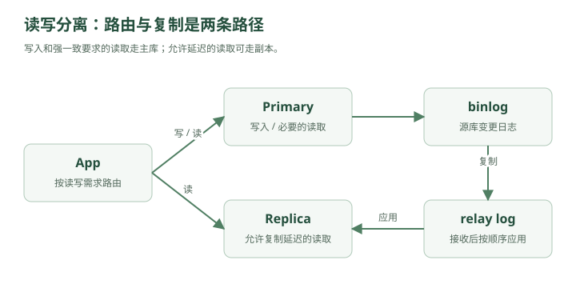

# 数据库开始冒烟——MySQL 主从复制与读写分离

林默原本以为，Redis 上线之后，系统终于轻松了。

现在架构是：

```text
                      ┌→ App A
用户 → Load Balancer ─┼→ App B
                      └→ App C
                           │
                           ▼
                         Redis
                           │
                           ▼
                         MySQL
```

大多数热点查询都被 Redis 挡住了。

MySQL 压力确实下降了。

林默看着监控：

```text
CPU：35%
连接数：正常
慢查询：很少
```

“这次总该稳了吧？”

老周没说话。

三天后。

事故来了。

---

## 一、不是所有请求都能被缓存

有些数据适合缓存。

比如：

```text
用户昵称
商品详情
热门文章
配置项
```

因为它们：

```text
读很多
写很少
```

但有些数据不一样。

比如订单。

用户打开：

```text
我的订单
```

可能必须看到最新状态：

```text
待支付
已支付
已发货
已签收
```

库存也是：

```text
100
99
98
97
```

这种数据如果缓存几分钟，很可能出问题。

所以大量请求最终还是要查 MySQL。

---

## 二、系统开始出现“读多写少”

老周调出了数据库监控：

```text
SELECT QPS：18000

INSERT/UPDATE QPS：1200
```

林默一看：

“读请求比写请求多十几倍。”

这其实非常常见。

比如电商商品：

```text
1 次修改商品价格

可能对应

100000 次商品详情查看
```

社交网站：

```text
1 次发动态

对应

大量用户阅读
```

所以很多互联网系统都有一个明显特征：

> **读多，写少。**

林默问：

“那是不是可以把读请求分散出去？”

老周：

“对。”

---

## 三、第二台 MySQL 出现了

老周画：

```text
             写
App ─────────────→ MySQL Master
                     │
                     │ 复制
                     ▼
                 MySQL Slave
                     ↑
                     │
                    读
```

这就是：

### 主从复制

Master-Slave Replication。

后来也常叫：

```text
Primary
Replica
```

主库负责：

```text
INSERT
UPDATE
DELETE
```

从库主要负责：

```text
SELECT
```

于是原本：

```text
18000 SELECT
1200 WRITE

全部打主库
```

现在变成：

```text
主库：
1200 WRITE
部分 SELECT

从库：
大量 SELECT
```

主库压力显著下降。

---

## 四、数据怎么从主库跑到从库？

林默有点疑惑：

“主库写完数据，从库怎么知道？”

老周说：

“靠日志。”

MySQL 主库每次修改数据时，会记录：

### binlog

Binary Log。

比如：

```text
用户余额：
100 → 80
```

主库不仅修改数据，还写 binlog。

可以粗略理解为：

```text
UPDATE account
SET balance = 80
WHERE id = 9527;
```

然后从库获取这些日志，再重放。这里的 SQL 用来说明变化；binlog 可以采用语句、行或混合格式，行格式记录的是行变化，并不总是保存这条 SQL。

于是：

```text
主库执行一次修改
       ↓
写 binlog
       ↓
从库读取
       ↓
从库执行同样变化
```

最终：

```text
Master
balance = 80

Slave
balance = 80
```

所以主从复制的本质其实就是：

> **主库把“我发生了什么变化”告诉从库，从库照着再做一遍。**

---

## 五、那为什么不直接让两台数据库都能写？

林默想得很自然：

“既然两台数据库都有完整数据，那两边都能写不是更快？”

比如：

```text
App A → DB A
App B → DB B
```

老周问：

“如果两边同时修改同一条数据呢？”

比如账户余额原来：

```text
100
```

请求一：

```text
DB A：扣 20
```

请求二：

```text
DB B：扣 30
```

同时发生。

那最后应该是多少？

```text
50
```

但如果双方独立写：

```text
DB A：80
DB B：70
```

然后互相同步。

谁覆盖谁？

冲突怎么解决？

林默开始头疼。

老周说：

> “写操作最难的地方，不是性能，而是一致性。”

所以很多架构先选择：

```text
一个主库统一写
多个从库负责读
```

把写冲突问题先规避掉。

---

## 六、读写分离正式出现

随着流量继续增加，系统变成：



<details class="original-diagram" markdown="1">
<summary>查看文字版示意</summary>

```text
App → DB Router ── 写 / 必要的读 ─→ Primary
                └─ 允许延迟的读 ─→ Replica
Primary ── binlog 复制 / relay log 应用 ─→ Replica
```

</details>

写请求：

```text
INSERT
UPDATE
DELETE
```

发给：

```text
Master
```

读请求：

```text
SELECT
```

发给：

```text
Slave
```

这就是：

### 读写分离

Read-Write Splitting。

---

## 七、从库也可以水平扩展

如果查询越来越多：

```text
Slave 1 扛不住
```

怎么办？

加：

```text
Slave 2
Slave 3
Slave 4
```

变成：

```text
                 ┌→ Replica A
Primary ─────────┼→ Replica B
                 ├→ Replica C
                 └→ Replica D
```

读请求：

```text
8000 QPS
```

可以平均：

```text
A：2000
B：2000
C：2000
D：2000
```

你会发现又回到了第一章那个规律：

> **一台扛不住，就增加机器，把压力分散出去。**

只不过这次扩展的不是 App。

而是数据库读取能力。

---

## 八、但新的 Bug 马上出现

某天，用户修改昵称。

原来：

```text
小明
```

改成：

```text
林默天下第一
```

请求：

```text
UPDATE user
SET name = '林默天下第一'
WHERE id = 9527;
```

写到了主库。

主库：

```text
name = 林默天下第一
```

然后前端立刻跳转个人主页。

页面查询：

```text
SELECT name
FROM user
WHERE id = 9527;
```

这次读请求被发到从库。

结果从库返回：

```text
小明
```

用户：

“？？？”

刷新一下。

又变成：

```text
林默天下第一
```

---

## 九、主从延迟

林默急了：

“从库不是复制主库的吗？”

老周：

“复制需要时间。”

比如：

```text
10:00:00.000
主库写成功

10:00:00.020
binlog 发送

10:00:00.050
从库开始应用

10:00:00.080
从库完成
```

这中间几十毫秒：

```text
主库：新数据
从库：旧数据
```

这就是：

### Replication Lag

主从复制延迟。

如果系统压力大，可能不是几十毫秒。

甚至：

```text
几百毫秒
几秒
几十秒
```

---

## 十、这意味着什么？

读写分离并不是免费午餐。

你获得：

```text
更强的读能力
```

但付出的代价是：

```text
短时间的数据不一致
```

也就是说：

```text
写成功
≠
所有数据库节点立刻看到最新数据
```

这就是分布式系统里非常核心的一个词：

### 最终一致性

Eventual Consistency。

意思是：

> **短时间内可以不一致，但最终会一致。**

---

## 十一、所有数据都能接受最终一致吗？

老周问林默：

“头像更新后，几百毫秒看到旧头像，能接受吗？”

“能。”

“点赞数差一点？”

“很多时候也能。”

“银行余额呢？”

林默：

“不能。”

“库存扣减呢？”

“不能随便旧。”

于是林默终于意识到：

> **一致性不是越强越好，而是看业务。**

不同数据要求不同。

例如：

```text
昵称、头像
→ 可以接受短暂延迟

评论数、点赞数
→ 通常可以最终一致

订单状态
→ 要更谨慎

余额、支付
→ 通常要求强一致或更强保证
```

---

## 十二、那“写完马上读”怎么办？

这个问题叫：

### Read Your Writes

读己之写。

用户自己刚刚修改的数据，通常希望自己马上能看到。

常见方案之一：

```text
刚写完之后的一段时间
强制读主库
```

例如：

```text
用户修改昵称
    ↓
写 Primary
    ↓
接下来 1 秒内查询本人信息
    ↓
直接查 Primary
```

其他普通查询：

```text
查 Replica
```

这样既能：

```text
保证关键场景一致
```

又不会：

```text
所有读请求都压主库
```

---

## 十三、另一种方案：关键查询直接读主库

比如：

```text
支付后查询订单状态
```

这个场景很关键。

可以直接：

```text
写主库
↓
读主库
```

而普通历史订单列表：

```text
读从库
```

这就是系统设计里常见的思想：

> **不要追求全局统一策略，而是针对不同业务做取舍。**

---

## 十四、然后主库挂了

某天凌晨。

报警响了。

```text
Primary DOWN
```

林默瞬间坐起来。

从库都还活着。

但问题是：

```text
SELECT 还能做
```

可是：

```text
INSERT
UPDATE
DELETE
```

全部失败。

用户：

```text
不能下单
不能支付
不能发帖
```

整个系统几乎瘫痪。

林默问：

“不是有从库吗？选一个顶上不行？”

老周：

“对，这就是下一步。”

---

## 十五、主从切换

原本：

```text
Primary
   │
   ├→ Replica A
   └→ Replica B
```

Primary 挂掉后：

```text
Replica A
```

被提升为：

```text
New Primary
```

然后：

```text
New Primary
   │
   └→ Replica B
```

这叫：

### Failover

故障转移。

系统自动：

```text
发现主库挂了
↓
选择一个从库
↓
提升为新主库
↓
应用连接到新主库
```

这就是高可用设计的一部分。

---

## 十六、但切主也不是那么简单

假设：

```text
主库刚写入订单 A
```

但这个 binlog 还没同步到 Replica A。

突然主库断电。

Replica A 被提升成主库。

结果：

```text
订单 A
```

在新主库上不存在。

林默：

“数据丢了？”

老周：

“有可能。”

这就是复制模式中的一个核心权衡。

---

## 十七、同步复制和异步复制

最简单的是：

### 异步复制

主库：

```text
数据写成功
↓
直接返回客户端成功
↓
之后慢慢同步从库
```

优点：

```text
快
```

缺点：

```text
主库突然挂
可能丢少量数据
```

---

另一种思路：

### 同步复制

主库：

```text
写数据
↓
等从库确认
↓
再返回成功
```

优点：

```text
数据更安全
```

缺点：

```text
写入更慢
```

因为每次写都需要等待网络和从库。

MySQL 半同步复制等待至少指定数量的副本确认事件已写入并刷盘到 relay log，不要求副本已经执行事务。因此，半同步并不等于读副本没有延迟；等待超时后还可能退回异步复制。故障切换也需要独立的检测、选主、旧主隔离和流量切换机制。

这些方案，本质都是在：

```text
性能
和
可靠性
```

之间找平衡。

---

## 十八、系统设计里最重要的思维开始出现了

林默突然发现：

每一种架构升级都不是纯赚。

比如：

### 加 Redis

获得：

```text
性能
```

付出：

```text
缓存一致性复杂度
```

### 加主从

获得：

```text
读性能
高可用
```

付出：

```text
复制延迟
一致性问题
运维复杂度
```

### 异步复制

获得：

```text
低延迟
```

付出：

```text
故障时可能丢数据
```

### 同步复制

获得：

```text
更强可靠性
```

付出：

```text
更高延迟
```

老周说：

> “真正的系统设计不是找完美方案。”

> “因为完美方案通常不存在。”

> **而是在性能、成本、一致性、可用性、复杂度之间做取舍。**

---

## 十九、可是从库加再多，也解决不了一个问题

几年后。

业务继续增长。

系统现在有：

```text
1亿用户
```

用户表：

```text
100000000 行
```

订单表：

```text
20亿行
```

即使读请求可以：

```text
Replica 1
Replica 2
Replica 3
...
```

但写请求依然必须：

```text
→ Primary
```

一天产生：

```text
5000万条订单数据
```

主库开始出现：

```text
磁盘越来越大
索引越来越大
备份越来越慢
DDL 越来越危险
写 QPS 越来越高
```

林默想：

“那我继续加从库？”

老周摇头。

> “从库只能扩展读。”

> “你的问题现在是——”

他在白板写：

### 单库本身太大了

以及：

### 单主写入能力达到上限

这次已经不是：

```text
多复制几份
```

能解决的。

需要把：

```text
一个数据库
```

真正拆成：

```text
多个数据库
```

林默看到这里，已经隐约猜到了那个以前面试最讨厌的问题。

老周写下四个字：

### 分库分表

---

## 第三章结束

现在系统已经进化成：

```text
                           ┌→ App 1
用户 → Load Balancer ──────┼→ App 2
                           └→ App 3
                                │
                          ┌─────┴─────┐
                          │           │
                        Redis      DB Router
                                      │
                          ┌───────────┴──────────┐
                          ▼                      ▼
                       Primary               Replicas
                          │               ┌────┼────┐
                          │               ▼    ▼    ▼
                          └────────────→ R1    R2   R3
```

这一章真正需要记住的链条是：

```text
单库压力大
↓
发现读多写少
↓
主从复制
↓
读写分离
↓
读能力水平扩展
↓
主从延迟
↓
最终一致性
↓
关键请求读主库
↓
主库单点
↓
Failover
↓
同步/异步复制取舍
↓
最后发现写能力和数据量仍然有极限
↓
分库分表
```

以后面试官问：

> “为什么要做 MySQL 主从？”

最好不要只回答：

> “为了读写分离。”

完整逻辑应该是：

> **单库读压力过大时，可以通过主从复制增加多个只读副本，将大量查询请求分散到从库，从而提升读吞吐，同时从库也可以用于故障转移和提高可用性。但代价是存在复制延迟，所以系统需要根据业务的一致性要求决定哪些请求读主库、哪些可以读从库。**

下一章就是系统设计里第一次真正进入“很像大厂架构”的部分：

### 下一章：一张订单表塞进了 20 亿行——分库分表与一致性哈希

会把 **为什么分表、为什么分库、水平拆分、垂直拆分、按 userId 取模、扩容为什么会翻车、一致性哈希、全局 ID、跨库查询** 全部通过同一个事故串起来。

行，下一章。
