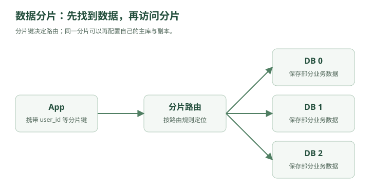

# 一张订单表塞进了 20 亿行——分库分表与一致性哈希

林默原本以为，给 MySQL 加了主从之后，数据库的问题已经解决得差不多了。

现在系统是：

```text
                           ┌→ App 1
用户 → Load Balancer ──────┼→ App 2
                           └→ App 3
                                │
                          ┌─────┴─────┐
                          │           │
                        Redis      DB Router
                                      │
                             ┌────────┴────────┐
                             ▼                 ▼
                          Primary          Replicas
```

读请求可以分散。

主库挂了也可以做 Failover。

看起来很不错。

直到有一天，DBA 发来一条消息：

> “订单表 20 亿行了。”

林默第一反应：

“20 亿行怎么了？MySQL 又不是不能存。”

DBA 沉默了几秒。

然后把监控发给他。

```text
orders 表：

数据量：2.1 TB
索引：780 GB
单次备份：9 小时
部分 SQL：3~8 秒
新增索引：不敢动
DDL：不敢动
磁盘：快满了
```

林默：

“……”

老周看了一眼。

“欢迎来到数据库的下一个阶段。”

---

## 一、20 亿行真正可怕的地方是什么？

很多人第一次听到：

```text
20 亿行
```

会觉得：

> “是不是因为 SELECT 会扫描 20 亿条？”

其实如果索引设计得好：

```sql
SELECT *
FROM orders
WHERE id = 123456;
```

MySQL 并不会真的扫 20 亿行。

B+ Tree 仍然可以快速定位。

所以“大表问题”不是简单一句：

> 数据多，所以查询慢。

真正的问题是整个系统开始变得笨重。

比如索引。

假设：

```text
orders
```

上有：

```text
PRIMARY KEY(id)
INDEX(user_id)
INDEX(create_time)
INDEX(status)
```

数据越来越多之后，每个索引也越来越大。

可能已经大到：

```text
无法全部放进内存
```

于是查询开始频繁访问磁盘。

缓存命中率下降。

然后：

```text
随机 IO 增加
↓
查询延迟上升
```

---

再比如备份。

以前：

```text
100 GB
```

备份一下没什么。

后来：

```text
2 TB
```

全量备份变得非常慢。

恢复更可怕。

你可以备份 9 小时。

但真出事故时，业务能等你恢复 9 小时吗？

---

再比如 DDL。

产品经理说：

> “订单表加一个字段。”

以前：

```sql
ALTER TABLE orders ADD COLUMN source INT;
```

林默啪一下就执行了。

现在看到：

```text
20 亿行
```

他手都不敢点 Enter。

---

## 二、老周提出了一个问题

老周问：

“这些 20 亿订单，需要放在同一台机器吗？”

林默：

“什么意思？”

老周画了一张图：

```text
原来：

orders

20亿条
```

然后把它从中间切开：

```text
orders_0
10亿条

orders_1
10亿条
```

林默眼睛一亮。

> “分表？”

“对。”

---

## 三、分表：把一张大表切成很多小表

比如原来：

```text
orders
20 亿行
```

拆成：

```text
orders_0
orders_1
orders_2
orders_3
```

每张：

```text
5 亿行
```

这就是：

### 水平分表

Horizontal Partitioning。

为什么叫“水平”？

想象一张表：

```text
id | user_id | amount | status
--------------------------------
1
2
3
4
5
6
```

横着切：

```text
表A：
1
2
3

表B：
4
5
6
```

字段没变。

只是：

> **把不同的行分开。**

所以叫水平拆分。

---

## 四、垂直拆分又是什么？

老周又画：

```text
user 表：

id
name
phone
email
avatar
address
bio
preferences
last_login
...
```

林默说：

“字段好多。”

“对。”

如果一张表字段特别多，而且不同字段访问频率不同，也可以拆。

例如：

```text
user_basic

id
name
phone
email
```

以及：

```text
user_profile

user_id
avatar
address
bio
preferences
```

这叫：

### 垂直分表

Vertical Partitioning。

也就是：

> **按列拆。**

记忆非常简单：

```text
水平拆分
→ 拆行

垂直拆分
→ 拆列
```

---

## 五、分表之后，问题只是缓解了一部分

林默把订单拆成：

```text
orders_0
orders_1
orders_2
orders_3
```

但四张表还在：

```text
同一个 MySQL 实例
```

也就是说：

```text
同一块 CPU
同一块内存
同一套磁盘 IO
```

单机写入能力还是有限。

于是老周问：

> “既然表都可以拆，数据库为什么不能拆？”

---

## 六、分库出现了

原来：

```text
MySQL A

orders_0
orders_1
orders_2
orders_3
```

现在：

```text
DB 0
└── orders_0

DB 1
└── orders_1

DB 2
└── orders_2

DB 3
└── orders_3
```

请求真正被分散到不同机器。

这叫：

### 分库

Sharding。

现在：

```text
写请求 20000 QPS
```

理论上可以变成：

```text
DB0：5000
DB1：5000
DB2：5000
DB3：5000
```

这一次，扩展的不只是：

```text
读能力
```

连：

```text
写能力
存储容量
```

都可以水平扩展。

林默终于明白：

> 主从主要是在复制数据。

而：

> 分库是在拆数据。

这是两件完全不同的事情。

---

## 七、最关键的问题来了：一条订单到底放哪？



林默准备了四个库：

```text
DB0
DB1
DB2
DB3
```

然后突然发现：

用户下了一个订单：

```text
orderId = 938127
```

放哪个库？

不能随机。

否则以后查询时，你根本不知道它在哪。

老周说：

“所以你需要一个分片规则。”

### Sharding Key

分片键。

---

## 八、最简单的规则：取模

假设根据：

```text
user_id
```

分库。

四个库：

```text
DB0
DB1
DB2
DB3
```

公式：

```text
user_id % 4
```

例如：

```text
1000 % 4 = 0
→ DB0

1001 % 4 = 1
→ DB1

1002 % 4 = 2
→ DB2

1003 % 4 = 3
→ DB3
```

非常简单。

而且查询用户订单时也很方便。

例如：

```text
user_id = 1001
```

直接计算：

```text
1001 % 4 = 1
```

于是直接：

```text
查 DB1
```

不用：

```text
DB0、DB1、DB2、DB3 全部查一遍
```

---

## 九、为什么经常用 user_id 做分片键？

订单系统中，经常有一个核心查询：

```text
查询某用户的所有订单
```

如果按：

```text
user_id
```

分片，那么同一个用户的数据天然落到同一个库。

例如：

```text
user 1001 的所有订单
↓
DB1
```

查询很方便。

但如果你按：

```text
order_id
```

分片。

那 user 1001 的订单可能是：

```text
订单 A → DB0
订单 B → DB3
订单 C → DB1
订单 D → DB2
```

那么：

```text
查询 user 1001 所有订单
```

就必须：

```text
DB0
DB1
DB2
DB3
```

全查。

所以分片键选择本质上取决于：

> **你的主要访问模式是什么。**

这句话非常重要。

系统设计不是：

> “user_id 一定比 order_id 好。”

而是：

> **根据最重要的查询方式决定数据怎么放。**

---

## 十、但取模方案埋着一颗炸弹

四个库用了两年。

后来业务继续增长。

DBA：

> “4 个库不够了，加到 8 个吧。”

林默：

“简单。”

原来：

```text
user_id % 4
```

改成：

```text
user_id % 8
```

然后老周问：

“那原来的数据呢？”

林默愣住了。

例如：

```text
user_id = 1006
```

以前：

```text
1006 % 4 = 2
```

所以在：

```text
DB2
```

扩容之后：

```text
1006 % 8 = 6
```

现在应该在：

```text
DB6
```

位置变了。

再比如：

```text
1007 % 4 = 3

1007 % 8 = 7
```

也变了。

实际上，大量数据都会重新定位。

于是你必须：

### 数据迁移

```text
DB2 的部分数据 → DB6
DB3 的部分数据 → DB7
...
```

而且迁移期间业务还在不断写新订单。

事情一下子复杂起来。

---

## 十一、扩容为什么是分库分表最痛苦的阶段之一？

假设有：

```text
10 TB 数据
```

现在你要重分片。

你不能简单：

```text
停机 8 小时
搬完
开机
```

用户不能下单 8 小时，老板可能先把林默搬出去。

所以通常需要做到：

```text
在线扩容
```

这意味着迁移过程中：

```text
旧库还在提供服务
新库也开始接数据
```

于是出现各种麻烦：

```text
历史数据在哪？
新数据写哪里？
迁移中的数据读哪个库？
如何防止漏数据？
如何校验一致性？
什么时候切流量？
```

老周说：

> “真正难的从来不是 userId % N 这一行代码。”

> “而是 N 发生变化以后怎么办。”

---

## 十二、一致性哈希登场

林默问：

“有没有一种算法，加机器的时候别让大部分数据都搬家？”

老周：

“有。”

然后画了一个圆。

```text
              0
         ┌─────────┐
      15 │         │ 3
         │         │
      12 │         │ 6
         └─────────┘
              9
```

林默：

“钟？”

“可以这么理解。”

这叫：

### Hash Ring

哈希环。

---

## 十三、把机器放到环上

假设：

```text
DB A
DB B
DB C
```

分别经过 Hash：

```text
hash(A)
hash(B)
hash(C)
```

落到环上：

```text
            A
        ┌───────┐
     C  │       │
        │       │
        └───────┘
            B
```

然后数据也 Hash。

比如：

```text
user1001
```

经过：

```text
hash(user1001)
```

也落到环上的某个位置。

然后规定：

> **顺时针找到的第一台机器，就是它所属的机器。**

例如：

```text
user1001
   ↓
   ●
    \
     \ 顺时针
      ↓
     DB B
```

那么 user1001 就存 DB B。

---

## 十四、增加一台机器时发生什么？

原本：

```text
A
B
C
```

现在增加：

```text
D
```

D 插到环上的某个位置。

那么只有：

```text
D 前面那一小段区间
```

的数据需要移动到 D。

而不是所有数据重新计算位置。

这就是一致性哈希最核心的价值：

> **节点数量变化时，尽量减少数据迁移。**

---

## 十五、但是一致性哈希也不是万能药

林默马上问：

“那以后分库分表都用一致性哈希不就行了？”

老周摇头。

数据库分片中，工程上并不意味着所有场景都会直接采用一致性哈希。

因为数据库还有很多需求：

```text
范围查询
事务
数据迁移
容量规划
热点隔离
运维管理
```

一致性哈希最经典的应用场景，反而经常出现在：

```text
缓存节点
分布式存储
负载分配
```

比如有：

```text
Redis A
Redis B
Redis C
```

根据 Key 决定去哪个 Redis。

这时节点动态增加或减少，一致性哈希就非常适合。

所以面试时不要说：

> “分库分表扩容一定用一致性哈希。”

更准确应该是：

> **一致性哈希是一种减少节点变化时数据重新映射的方案，但具体数据库分片还需要结合业务、路由规则和迁移方案设计。**

---

## 十六、虚拟节点

一致性哈希还有一个问题。

假设三台机器非常倒霉：

```text
A
B
C
```

Hash 后位置很不均匀。

比如：

```text
       A
       |
       |
       |
       B-C
```

那可能导致：

```text
A 负责 70%
B 负责 20%
C 负责 10%
```

压力严重不均。

怎么办？

引入：

### Virtual Node

虚拟节点。

不是让：

```text
A
```

只在环上出现一次。

而是：

```text
A1
A2
A3
A4
...
```

同样：

```text
B1 B2 B3...
C1 C2 C3...
```

这些虚拟节点最终都映射到真实机器。

这样分布会更加均匀。

---

## 十七、另一个问题出现了：ID 冲突

分库之前，订单 ID：

```sql
AUTO_INCREMENT
```

非常舒服。

比如：

```text
1
2
3
4
5
```

但现在：

```text
DB0
DB1
DB2
DB3
```

都有自己的自增 ID。

于是：

```text
DB0：
1
2
3

DB1：
1
2
3
```

合起来：

```text
order_id = 1
```

出现两次。

不行。

于是系统需要：

### 全局唯一 ID

Global ID。

---

## 十八、最简单的方案：UUID

每个服务自己生成：

```text
550e8400-e29b-41d4-a716-446655440000
```

几乎不会冲突。

优点：

```text
简单
不依赖中心服务
全球唯一
```

缺点也明显：

```text
长
占空间
无序
```

这里主要讨论随机 UUID（例如 v4）；有序 UUID 的索引局部性有所不同。如果把随机 UUID 当 MySQL 主键，B+ Tree 插入位置很随机。

可能导致：

```text
页分裂
缓存局部性变差
索引更大
```

所以高并发数据库主键一般不太喜欢完全随机的 UUID。

---

## 十九、Snowflake 出现了

老周写了一个 64 位整数：

```text
186430291234567891
```

林默：

“这也是 ID？”

“对。”

这类方案最典型的就是：

### Snowflake

雪花算法。

一个 ID 可以粗略拆成：

```text
| timestamp | machine_id | sequence |
```

比如：

```text
时间戳
+
机器编号
+
当前毫秒内序列号
```

因此：

### 第一，唯一

不同机器：

```text
machine_id 不一样
```

同一机器同一毫秒：

```text
sequence 不一样
```

### 第二，趋势递增

因为高位通常是时间戳。

所以后生成的 ID 通常更大。

这对 B+ Tree 比随机 UUID 友好得多。

### 第三，不需要数据库自增

每台应用服务器都能自己生成。

性能很高。

---

## 二十、雪花算法又有坑

林默已经学会条件反射了：

“我猜你接下来要说但是。”

老周：

“不错。”

Snowflake 比较典型的问题之一：

### 时钟回拨

假设服务器时间：

```text
12:00:00
```

生成了一批 ID。

结果 NTP 校时：

```text
时间突然回到了 11:59:58
```

如果算法处理不好，就可能产生重复 ID。

所以真实系统要考虑：

```text
时钟回拨检测
等待
备用机器号
逻辑时间
```

等方案。

再次说明：

> 每个优雅算法背后，都有边界条件。

---

## 二十一、分库后最麻烦的事开始出现

产品经理突然说：

> “我要查询昨天所有订单金额前 100 名。”

以前：

```sql
SELECT *
FROM orders
WHERE create_time >= ...
ORDER BY amount DESC
LIMIT 100;
```

一个库。

搞定。

现在：

```text
DB0
DB1
DB2
DB3
```

怎么办？

每个库都可能有前 100 名。

所以需要：

```text
DB0 → Top 100
DB1 → Top 100
DB2 → Top 100
DB3 → Top 100
```

然后应用层：

```text
合并
排序
取最终 Top 100
```

分库之后，一些原本简单的 SQL suddenly 变复杂了。

---

## 二十二、分页也出事了

产品经理：

> “查第 10000 页订单。”

以前：

```sql
LIMIT 100000, 10
```

已经比较难受。

分库后更麻烦。

如果四个库分别有数据：

```text
DB0
DB1
DB2
DB3
```

你要拿全局：

```text
第 100001 ~ 100010 条
```

往往不能简单让每个库：

```text
LIMIT 100000,10
```

因为全局顺序需要合并。

于是：

```text
跨库分页
跨库排序
聚合统计
```

都会变困难。

---

## 二十三、JOIN 也开始崩

以前：

```sql
SELECT *
FROM orders o
JOIN users u
ON o.user_id = u.id;
```

现在：

```text
orders 在 DB3

users 可能在 DB1
```

MySQL 没法像以前那样轻松本地 JOIN。

这就是：

### 跨库 JOIN

问题。

常见解决思路包括：

```text
应用层 JOIN
数据冗余
搜索引擎
宽表
数据仓库
```

具体选哪个，要看业务。

---

## 二十四、为什么说“分库分表能不做就不做”？

林默终于问出了经典问题：

“既然分库分表这么麻烦，为什么网上一讲大系统就喜欢分库分表？”

老周：

“因为网上只画图。”

林默：

“……”

老周认真说：

> **分库分表不是高级，而是被逼出来的。**

在单库还能撑住时：

```text
单库
```

通常比：

```text
8库64表
```

好维护得多。

因为分库分表会引入：

```text
复杂路由
跨库查询
跨库事务
扩容迁移
全局 ID
分页排序
数据一致性
运维复杂度
```

所以正确顺序通常不是：

```text
项目刚上线
↓
先分 64 个库
```

而是：

```text
优化 SQL
↓
优化索引
↓
加缓存
↓
读写分离
↓
升级硬件
↓
确认单库真的成为瓶颈
↓
再考虑分库分表
```

这是非常重要的工程判断。

---

## 二十五、一个面试场景

面试官问林默：

> “有 10 亿条订单数据，你怎么设计？”

以前林默可能会直接答：

> “分库分表，用 userId hash 取模。”

现在他不会这么答了。

他会先问：

```text
用户量多少？
QPS 多少？
读写比例是多少？
主要查询条件是什么？
按用户查订单多，还是按订单号查多？
是否需要全局排序？
历史订单是否需要实时查询？
单库目前瓶颈是什么？
```

因为：

> **数据量大，不一定等于必须分库。**

如果这 10 亿条数据大部分是：

```text
5年前历史数据
```

可能直接：

```text
冷热分离
```

把旧数据归档，比立刻分 64 个库更简单。

---

## 二十六、冷热数据分离

订单系统里：

```text
最近 3 个月订单
```

访问特别频繁。

三年前的订单：

```text
一年可能查一次
```

那为什么都放在昂贵的在线数据库里？

可以：

```text
热数据
↓
MySQL

冷数据
↓
归档库 / 对象存储 / 数仓
```

用户如果查询三年前订单：

```text
慢一点也可以接受
```

这样甚至可能避免过早分库。

系统设计再次回到了那个原则：

> **根据业务，而不是根据技术名词设计。**

---

## 二十七、林默重新整理了数据库扩展路线

他在白板上写：

```text
第一阶段：

单 MySQL
```

压力增加：

```text
↓
索引优化
SQL 优化
```

读请求太多：

```text
↓
Redis
↓
主从复制
↓
读写分离
```

单库数据太大：

```text
↓
归档 / 冷热分离
```

还不够：

```text
↓
分表
```

单机 CPU、IO、写能力也到极限：

```text
↓
分库
```

于是形成完整路线：

```text
单库
 ↓
缓存
 ↓
主从
 ↓
读写分离
 ↓
冷热分离
 ↓
分库分表
```

---

## 二十八、但就在林默准备下班的时候……

运营突然跑了进来。

“出事了！”

“又怎么了？”

“今晚秒杀活动。”

“预计多少人？”

“200 万。”

“商品多少件？”

“1 万件。”

林默沉默。

也就是说：

```text
200万人
同时抢
1万件商品
```

哪怕数据库已经分库。

瞬间可能仍然出现：

```text
几十万 QPS
```

请求像洪水一样同时冲进系统。

数据库可能还没来得及慢慢处理，就已经被连接打爆。

林默问：

“继续加数据库？”

老周摇头。

“你现在的问题，不是总处理能力不够。”

“而是——”

他在白板上画了一条巨大的尖峰：

```text
QPS

        /\
       /  \
      /    \
_____/      \_____
```

“流量在某一瞬间太高。”

林默看着这座尖峰。

突然想起一个词。

> **削峰。**

老周点点头。

然后在数据库前面画了一个盒子：

```text
用户
 ↓
App
 ↓
？？？
 ↓
MySQL
```

盒子里面写着：

### Message Queue

消息队列。

---

## 第四章结束

现在整个系统已经继续进化：

```text
                         ┌→ App 1
用户 → Load Balancer ────┼→ App 2
                         └→ App 3
                              │
                       ┌──────┴──────┐
                       │             │
                     Redis       DB Router
                                     │
                    ┌────────────────┼────────────────┐
                    ▼                ▼                ▼
                  Shard 0          Shard 1          Shard 2
                    │                │                │
                 Replica          Replica          Replica
```

这一章真正需要记住的是这条因果链：

```text
单表越来越大
↓
分表
↓
单机资源仍然有限
↓
分库
↓
需要决定数据放哪
↓
Sharding Key
↓
Hash / 取模
↓
扩容导致大量数据重新映射
↓
一致性哈希可以减少节点变化时的数据迁移
↓
分库后自增 ID 冲突
↓
全局 ID / Snowflake
↓
跨库 JOIN、排序、分页、事务变复杂
↓
所以分库分表不是越早越好
```

你现在已经有一个很关键的系统设计直觉了：

> **水平扩展解决容量问题，但会把原本单机内部的问题，变成分布式协调问题。**

下一章我们就接秒杀事故：

### 下一章：两百万人同时按下购买键——消息队列、削峰与异步化

会自然串起：

**为什么要 MQ → 削峰填谷 → 同步转异步 → Kafka / RabbitMQ 的角色 → 消息丢失 → 重复消费 → 幂等 → 顺序消息 → 消息积压 → 最终一致性。**

行，下一章。
