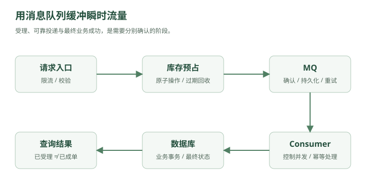

# 两百万人同时按下购买键——消息队列、削峰与异步化

晚上 7 点 59 分 50 秒。

秒杀活动页面已经打开。

商品：

```text
某款热门显卡
库存：10000
```

预约人数：

```text
2,000,000
```

林默盯着监控。

QPS 还很低。

```text
300
500
800
```

8 点整。

所有人同时点下：

```text
立即购买
```

监控图瞬间变成：

```text
QPS

            /\
           /  \
          /    \
_________/      \________
```

峰值：

```text
280,000 QPS
```

数据库连接池：

```text
200/200
```

应用线程：

```text
全部占满
```

MySQL：

```text
CPU 100%
```

然后开始：

```text
timeout
timeout
timeout
```

整个系统像被一拳打懵。

---

## 一、真正的问题不是“总请求太多”

林默第一反应：

“是不是机器太少？”

老周问：

“这 200 万个请求，是一直这么多吗？”

“不，主要就是 8 点那几分钟。”

“那你为了 5 分钟流量，准备平时养几百台机器？”

林默沉默。

这时老周画了一条线：

```text
正常流量：

____----____----____

秒杀流量：

___________/\___________
```

他说：

> “你现在的问题，不是一天处理不了这么多请求。”

而是：

> **请求在同一时间涌进来了。**

这就是：

### 流量尖峰

Traffic Spike。

---

## 二、如果一次只能处理 5000 个怎么办？

假设数据库稳定承受：

```text
5000 requests/s
```

但一瞬间来了：

```text
200000 requests/s
```

直接硬扛：

```text
200000
   ↓
MySQL
```

必炸。

老周问：

“如果这些请求不要求立刻执行呢？”

林默：

“什么意思？”

“先排队。”

---

## 三、消息队列正式登场

老周在系统中间画了一个盒子：

```text
用户
 ↓
App
 ↓
Message Queue
 ↓
Consumer
 ↓
MySQL
```

用户请求不再直接冲数据库。

而是：

```text
用户
 ↓
把“下单请求”写入队列
 ↓
立即返回“处理中”
```

后台消费者慢慢处理：

```text
MQ
 ↓
5000/s
 ↓
MySQL
```

于是原本：

```text
200000/s
   ↓
MySQL
```

变成：

```text
200000/s
   ↓
MQ
   ↓
5000/s
   ↓
MySQL
```

数据库终于可以喘气。

这就是：

### 削峰填谷

Peak Shaving。

---

## 四、为什么叫削峰填谷？

想象水库。

暴雨来了：

```text
上游洪水
↓↓↓↓↓↓↓↓↓↓
```

如果直接冲下游：

```text
洪水
↓
城市
↓
淹了
```

加一个水库：

```text
洪水
 ↓
水库
 ↓
慢慢放水
 ↓
城市
```

消息队列在系统里就是这个水库。

请求高峰时：

```text
先积在 MQ
```

流量低谷时：

```text
Consumer 继续处理
```

于是：

> **把瞬时压力，变成一段时间内的稳定压力。**

---

## 五、这就是系统设计里一个极重要的思想：缓冲

其实你之前已经见过类似思想。

比如：

```text
CPU 和内存速度不一致
↓
Cache
```

生产者和消费者速度不一致：

```text
Producer 太快
Consumer 太慢
↓
Queue
```

所以 MQ 本质上不仅是“发消息”。

它还是一个：

### Buffer

缓冲层。

---

## 六、同步调用为什么危险？

原来下单流程：

```text
用户点击下单
 ↓
创建订单
 ↓
扣库存
 ↓
扣优惠券
 ↓
发短信
 ↓
发邮件
 ↓
写积分
 ↓
记录日志
 ↓
返回成功
```

假设每一步：

```text
创建订单 50ms
扣库存   30ms
优惠券   40ms
短信     200ms
邮件     300ms
积分     50ms
```

总延迟：

```text
670ms+
```

而且只要邮件服务挂了：

```text
用户下单失败？
```

这显然很奇怪。

用户买东西，为什么要等邮件发完？

---

## 七、异步化

于是老周把流程拆成：

```text
用户
 ↓
创建订单
 ↓
扣库存
 ↓
返回成功
```

同时发送消息：

```text
OrderCreated
```

然后：

```text
                ┌→ 短信服务
                ├→ 邮件服务
OrderCreated → MQ ├→ 积分服务
                └→ 日志服务
```

用户无需等待后续流程完成。

这叫：

### 异步化

Asynchronous Processing。

---

## 八、同步和异步到底差在哪？

同步：

```text
A → B → C → D

A 必须等 B
B 必须等 C
C 必须等 D
```

任何一环慢：

```text
整条链路慢
```

任何一环挂：

```text
整条链路可能失败
```

异步：

```text
A → MQ

然后：

MQ → B
MQ → C
MQ → D
```

A 把消息放进去就可以继续。

于是系统获得：

```text
更低响应延迟
更好的解耦
更强的抗峰值能力
```

---

## 九、MQ 的三个核心价值

林默总结：

## 1. 削峰

```text
瞬时 20 万 QPS
↓
MQ
↓
稳定 5000 QPS 消费
```

## 2. 异步

```text
非核心流程
不阻塞用户请求
```

## 3. 解耦

原来：

```text
订单服务
 ↓
短信服务
 ↓
邮件服务
 ↓
积分服务
```

订单服务需要知道所有下游。

现在：

```text
订单服务
 ↓
MQ
```

下游自己订阅。

订单服务甚至不需要知道：

```text
到底有几个消费者
```

---

## 十、但 MQ 一上线，新的问题立刻来了

某天用户付款成功。

订单服务发送：

```text
PaymentSuccess
```

准备让履约服务发货。

结果：

```text
订单服务
 ↓
发送消息
 ↓
网络断了
```

消息没进 MQ。

数据库里：

```text
订单 = 已支付
```

但下游永远没收到：

```text
PaymentSuccess
```

于是：

```text
钱扣了
货没发
```

林默脸色变了。

老周：

> “消息队列最难的地方，从来不是 send()。”

而是：

### 消息可靠性

---

## 十一、第一种事故：消息丢失

消息可能在哪丢？

整条链路：

```text
Producer
 ↓
Broker
 ↓
Consumer
```

三个地方都可能出事。

### Producer 丢

```text
发送失败
```

### Broker 丢

```text
消息刚进内存
MQ 宕机
```

### Consumer 丢

```text
消费者拿到消息
还没处理完
就确认成功
然后进程挂了
```

所以要保证可靠性，就必须考虑整个链路。

---

## 十二、Producer 怎么保证消息真的发出去？

最简单：

```text
send(message)
```

不够。

通常需要：

```text
发送
↓
等待 Broker ACK
↓
确认收到
```

如果没有 ACK：

```text
重试
```

于是：

```text
Producer
  ↓
Broker
  ↓
ACK
```

这样 Producer 才知道：

> “Broker 已按当前确认配置接收了消息；这还不代表消费者已处理成功。”

---

## 十三、Broker 怎么保证不丢？

如果 MQ 只是把消息放内存：

```text
RAM
```

机器断电：

```text
消息没了
```

所以重要消息通常需要：

### 持久化

Persistence。

比如写入：

```text
磁盘日志
```

并且 Broker 本身最好：

```text
多副本
```

这样一台机器挂了：

```text
Replica 还有数据
```

---

## 十四、Consumer 怎么保证处理完再确认？

错误流程：

```text
Consumer 收到消息
↓
立刻 ACK
↓
开始处理
↓
程序崩溃
```

对于 RabbitMQ 这类任务队列，Broker 可以把已确认的投递标记为可删除。Kafka 的 offset 提交含义不同：它推进消费位置，消息仍由保留策略管理。

消息永久消失。

所以更合理：

```text
Consumer 收到消息
↓
处理业务
↓
成功
↓
ACK
```

如果处理过程中挂了：

```text
Broker 没收到 ACK
↓
重新投递
```

这样消息就不容易丢。

---

## 十五、但是“消息不丢”马上带来另一个问题

林默很满意。

“那就重试，保证不丢。”

老周：

“那你考虑过重复吗？”

例如：

```text
Consumer 已经处理成功
```

库存扣了：

```text
100 → 99
```

然后准备 ACK。

就在此时：

```text
网络断了
```

Broker 没收到 ACK。

于是：

```text
重新发送这条消息
```

Consumer 又执行一次：

```text
99 → 98
```

但实际上只卖了一件商品。

这就是：

### 重复消费

---

## 十六、为什么很多 MQ 做不到“绝对只消费一次”？

在分布式系统里有一个非常麻烦的窗口：

```text
业务执行成功
↓
ACK 还没成功
```

如果这时崩溃：

系统很难判断：

```text
到底业务执行了没有？
```

所以工程上非常常见的语义是：

### At Least Once

至少一次。

意思是：

```text
在持久化、确认与重试等条件满足时争取至少处理一次
可能重复，仍需处理失败、过期与重试耗尽
```

既然可能重复，那业务就必须：

### 幂等

Idempotency。

---

## 十七、什么叫幂等？

一个操作执行：

```text
1 次
```

和：

```text
10 次
```

结果一样。

这就是幂等。

比如：

```sql
UPDATE orders
SET status = 'PAID'
WHERE id = 123;
```

执行一次：

```text
PAID
```

执行十次：

```text
还是 PAID
```

这种天然比较幂等。

但：

```sql
UPDATE account
SET balance = balance - 100
WHERE id = 1;
```

执行一次：

```text
1000 → 900
```

执行两次：

```text
1000 → 800
```

这就不幂等。

---

## 十八、如何做消费幂等？

最常见的办法之一：

每条业务消息有唯一 ID。

比如：

```text
message_id = abc123
```

Consumer 处理前：

```text
查询 abc123 是否处理过
```

如果处理过：

```text
直接跳过
```

没处理：

```text
执行业务
↓
记录 abc123 已处理
```

例如：

```text
processed_message

abc123
abc124
abc125
```

这就是：

### 去重

Deduplication。

> **工程补充**：“先查再做再记录”只表达思路，不能单独保证并发幂等。需要唯一约束，并将去重记录和业务更新放在同一个本地事务中；若涉及外部副作用，还需使用对方的幂等键或设计补偿、对账。

---

## 十九、数据库唯一索引也能做幂等

比如优惠券发放：

```text
user_id
coupon_id
```

建立唯一索引：

```sql
UNIQUE(user_id, coupon_id)
```

消息重复消费：

第一次：

```text
插入成功
```

第二次：

```text
唯一索引冲突
```

于是系统知道：

```text
已经处理过
```

这比单纯：

```text
先查再插
```

更可靠。

因为并发下：

```text
查
↓
都发现没有
↓
同时插
```

可能还是重复。

所以：

> **唯一约束往往是幂等设计的重要兜底。**

---

## 二十、消息顺序又出问题了

某个订单状态依次变化：

```text
CREATED
↓
PAID
↓
SHIPPED
↓
FINISHED
```

MQ 收到：

```text
消息1：PAID
消息2：SHIPPED
```

结果由于多个消费者并发：

```text
Consumer A 处理 SHIPPED
Consumer B 处理 PAID
```

最终状态可能变成：

```text
PAID
```

订单竟然从已发货退回已支付。

这就是：

### 消息乱序

---

## 二十一、顺序消息怎么做？

如果要求：

```text
同一个订单
```

的消息必须有序。

可以让相同：

```text
order_id
```

路由到同一个队列或同一个分区。

例如：

```text
hash(order_id) % partition_count
```

所以：

```text
order123 的所有消息
↓
Partition 2
```

再由单一逻辑顺序消费。

这样：

```text
CREATED
PAID
SHIPPED
FINISHED
```

才能按序处理。

注意这里的关键词：

> **通常保证的是“局部有序”，不是整个系统所有消息全局有序。**

因为全局有序意味着：

```text
所有消息
↓
一个队列
↓
一个消费者
```

吞吐量会非常差。

---

## 二十二、Kafka 为什么总提 Partition？

林默这时终于理解 Kafka 的一个核心设计。

假设一个 Topic：

```text
orders
```

只有一个 Partition。

那么：

```text
吞吐受一个 Partition 限制
```

把它拆成：

```text
Partition 0
Partition 1
Partition 2
Partition 3
```

不同消息可以并行处理。

例如：

```text
user/order hash
↓
不同 Partition
```

这样获得：

```text
更高吞吐
```

同时：

> **单个 Partition 内仍可以保持顺序。**

于是：

```text
并行性
和
局部顺序
```

得到一个平衡。

---

## 二十三、RabbitMQ 和 Kafka 怎么理解？

这里先不背详细区别。

用故事理解。

RabbitMQ 更像：

### 快递分拣中心

你发一个任务：

```text
请处理这个订单
```

Broker 负责把任务交给消费者。

常见强调：

```text
路由
确认
消费
队列语义
```

适合很多：

```text
业务异步任务
```

---

Kafka 更像：

### 巨型日志流水带

消息不断追加：

```text
offset 1
offset 2
offset 3
offset 4
...
```

消费者记录自己读到哪里：

```text
offset = 10086
```

因此非常适合：

```text
超高吞吐
日志
事件流
数据管道
Event Streaming
```

这只是直觉层面的区别。

并不是说：

```text
RabbitMQ 不能高吞吐
Kafka 不能做业务消息
```

而是二者设计重心不同。

---

## 二十四、然后消息开始积压

秒杀结束。

林默发现 MQ 监控：

```text
Queue Length:

100万
300万
800万
1200万
```

消费者：

```text
消费速度：5000/s
```

生产者：

```text
生产速度：30000/s
```

结果显然：

```text
每秒多积压 25000 条
```

这叫：

### 消息积压

Message Backlog。

---

## 二十五、消息积压怎么办？

先找原因。

可能：

```text
Consumer 太少
```

那就增加消费者。

```text
Consumer 1
Consumer 2
Consumer 3
...
```

如果 Topic 有足够 Partition，就可以并行消费。

---

也可能：

```text
单条消息处理太慢
```

比如每条：

```text
200ms
```

那要优化：

```text
数据库
外部 RPC
批处理
IO
```

---

也可能下游已经到极限。

例如数据库最多：

```text
5000/s
```

你就算开：

```text
1000 个 Consumer
```

也没用。

反而所有消费者一起打数据库：

```text
数据库再次挂掉
```

所以系统设计绝不能：

> “积压了就无脑加消费者。”

必须找真正瓶颈。

---

## 二十六、这引出了背压

如果消费者已经处理不过来，生产者是不是还应该无限往里塞？

不一定。

需要：

### Backpressure

背压。

本质是：

> **下游告诉上游：我已经吃不下了，你慢一点。**

比如：

```text
Consumer 处理不过来
↓
Queue 过长
↓
上游限流
```

或者：

```text
拒绝非关键请求
降级
```

这和生活里很像。

餐厅厨房只能做：

```text
100 单/小时
```

前台却接：

```text
10000 单/小时
```

队列再大也只是：

> 延迟死亡。

---

## 二十七、MQ 不能创造吞吐量

老周特别强调：

> “消息队列只是把压力推迟。”

假设数据库一天最多处理：

```text
1 亿条
```

你每天送进 MQ：

```text
10 亿条
```

那队列最终一定：

```text
无限增长
```

MQ 能解决：

```text
瞬时峰值
```

不能解决：

```text
长期处理能力不足
```

这点非常重要。

---

## 二十八、最难的问题来了：数据库成功，消息发送失败

某天下单。

代码：

```text
1. INSERT order
2. send OrderCreated
```

第一步：

```text
数据库成功
```

第二步：

```text
MQ 发送失败
```

于是：

```text
订单存在
```

但：

```text
下游永远不知道
```

如果反过来：

```text
1. send OrderCreated
2. INSERT order
```

第一步成功。

第二步数据库失败。

于是下游收到：

```text
一个根本不存在的订单
```

林默开始头疼。

这其实是：

### 本地事务与消息的一致性问题

---

## 二十九、Outbox Pattern

老周给了一个非常经典的方案。

不要直接：

```text
事务提交
+
发送 MQ
```

而是在同一个数据库事务里写两张表：

```text
BEGIN;

INSERT INTO orders ...;

INSERT INTO outbox(
    event_type,
    payload,
    status
) ...;

COMMIT;
```

于是：

```text
订单
和
待发送消息
```

要么一起成功。

要么一起失败。

之后一个后台任务：

```text
扫描 outbox
↓
发送 MQ
↓
发送成功
↓
标记 SENT
```

这叫：

### Transactional Outbox

事务 Outbox。

---

## 三十、为什么这个方案靠谱？

因为：

```text
orders
```

和：

```text
outbox
```

在同一个 MySQL 本地事务里。

MySQL 可以保证：

```text
原子性
```

于是避免：

```text
业务提交了
消息却完全没记录
```

至于 MQ 发送可能重复？

没关系。

我们前面已经解决：

```text
Consumer 幂等
```

你会发现系统设计很多方案是连锁的。

---

## 三十一、最终一致性再次出现

订单创建后：

```text
订单 DB
```

已经成功。

积分系统可能：

```text
100ms 后
```

才更新。

短信：

```text
1 秒后
```

才发送。

推荐系统：

```text
5 秒后
```

才看到这个事件。

它们不是同一时刻一致。

但最终都会追上。

这就是：

### 最终一致性

又出现了。

你现在应该开始看到：

> **最终一致性不是某一个技术点，而是大型分布式系统经常采用的一种取舍。**

---

## 三十二、回到秒杀

现在林默重新设计秒杀流程。

用户来了：



<details class="original-diagram" markdown="1">
<summary>查看文字版示意</summary>

```text
请求
 ↓
限流
 ↓
Redis 原子扣减库存
 ↓
成功
 ↓
发送 MQ
 ↓
返回“请求已受理，订单确认中”
```

</details>

后台：

```text
MQ
 ↓
创建订单
 ↓
支付
 ↓
履约
```

这样最危险的数据库写入不会直接面对：

```text
20 万 QPS
```

而是由 MQ 平滑处理。

---

## 三十三、但是为什么先扣 Redis 库存？

如果 200 万人抢 1 万件。

你没必要让：

```text
199 万个失败请求
```

全进 MQ。

更好的做法：

```text
Redis stock = 10000
```

用户请求先执行原子操作：

```text
if stock > 0:
    stock--
    success
else:
    sold out
```

只有前 1 万左右成功请求：

```text
进入 MQ
```

于是：

```text
200 万请求
↓
Redis
↓
1 万成功
↓
MQ
↓
DB
```

流量在前面就被截断。

> **工程补充**：Redis 预扣与 MQ 发送不构成跨系统原子事务。发送失败、订单创建失败或支付超时都可能留下预占库存，需要可靠事件记录、幂等补偿、预占超时与对账；受理成功不能直接等同于最终下单成功。

这就是系统设计里的另一条重要原则：

> **越便宜的过滤越往前放。**

---

## 三十四、为什么必须“原子扣库存”？

如果这样写：

```text
1. GET stock
2. 判断 stock > 0
3. SET stock = stock - 1
```

两个请求同时：

```text
A GET → 1
B GET → 1
```

然后：

```text
A SET → 0
B SET → 0
```

两个人都认为自己抢到了最后一件。

这就是并发竞态。

所以需要：

```text
Redis Lua
```

把：

```text
判断
+
扣减
```

放进一个原子操作。

这其实已经非常接近真实高并发权益/秒杀系统的设计了。

---

## 三十五、系统现在已经非常像一个真正的大型系统

现在架构：

```text
                            ┌→ App 1
Client → Load Balancer ─────┼→ App 2
                            └→ App 3
                                 │
                          ┌──────┴──────┐
                          │             │
                       Redis           MQ
                          │             │
                      快速判断        Consumer
                                        │
                                        ▼
                                     DB Shards
```

Redis：

```text
挡热点请求
库存原子扣减
Session
缓存
```

MQ：

```text
削峰
异步
解耦
```

DB：

```text
最终持久化业务数据
```

你会发现它们不是：

```text
随便堆中间件
```

而是每一层解决不同问题。

---

## 第五章结束

这一章最重要的因果链是：

```text
瞬时流量过高
↓
数据库扛不住
↓
消息队列
↓
削峰填谷
↓
异步化
↓
系统解耦
↓
消息可能丢失
↓
ACK + 持久化 + 重试
↓
重试导致重复消息
↓
幂等
↓
并发消费导致乱序
↓
分区内顺序
↓
消费者处理不过来
↓
消息积压
↓
扩消费者 / 优化下游 / 背压
↓
DB 和 MQ 无法天然一个事务
↓
Outbox
↓
最终一致性
```

面试遇到：

> “上游突然 10 万 QPS，但下游只能处理 500 QPS 怎么办？”

现在不要只回答一句：

> “用 MQ 削峰。”

更完整的逻辑应该是：

> **先判断这是短时尖峰还是持续流量。如果是短时尖峰，可以通过消息队列把同步请求转为异步任务，让上游快速入队，下游按自身处理能力稳定消费，实现削峰填谷。但还需要考虑队列容量、消息积压、消费并发、消息可靠性和幂等。如果长期生产速率高于消费速率，MQ 只能延迟问题，还必须扩展下游真实处理能力。**

下一章我们继续处理这个系统最危险的问题：

### 下一章：门外已经挤了两百万人——限流、熔断、降级与雪崩

到时候会把：

**固定窗口、滑动窗口、漏桶、令牌桶、Redis 限流、429、熔断器、Circuit Breaker、Fallback、服务雪崩、超时、重试风暴、隔离**

全部放进一次真正的“大规模事故”里。
