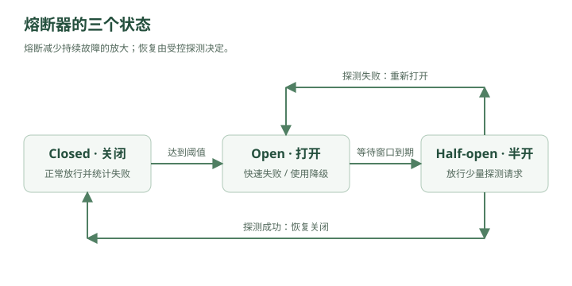

# 门外已经挤了两百万人——限流、熔断、降级与服务雪崩

秒杀系统上线之后，林默觉得自己已经把洪峰挡住了。

现在请求链路大概是：

```text
用户
 ↓
Load Balancer
 ↓
App
 ↓
Redis
 ↓
MQ
 ↓
Consumer
 ↓
MySQL
```

秒杀流量先经过 Redis。

抢到资格的请求才进入 MQ。

数据库终于不会被二百万人直接冲垮。

林默满意地看着监控：

```text
Redis：正常
MQ：正常
MySQL：正常
```

然后老周突然问：

> “Redis 能扛二百万请求，那你的 App 能吗？”

林默愣了一下。

是啊。

请求到 Redis 之前，首先得经过：

```text
Nginx
↓
Spring Boot
↓
线程
↓
连接
↓
业务代码
```

也就是说，即使最终只有一万个请求进数据库——

前面的应用服务器还是要接住：

```text
200 万个请求
```

老周说：

> “数据库不死，不代表系统不死。”

---

## 一、第一道城门：不是所有请求都应该进入系统

晚上八点整。

秒杀开始。

```text
2,000,000 用户
↓
同时点击
```

应用服务器瞬间：

```text
连接数：暴涨
CPU：95%
线程池：满
GC：频繁
```

大量请求甚至还没访问 Redis，App 就已经开始变慢。

林默问：

“那继续加 App？”

老周摇头。

“你只有一万件商品。”

“这二百万个请求，真的都值得进入核心系统吗？”

林默突然意识到：

```text
库存：10000

请求：2000000
```

99% 以上的人最终必然失败。

如果所有请求都完整执行：

```text
鉴权
↓
查询活动
↓
查询商品
↓
查 Redis
↓
业务判断
```

本身就是浪费资源。

于是老周在系统最前面画了一扇门：

```text
用户
 ↓
限流器
 ↓
系统
```

### Rate Limiting

限流。

---

## 二、限流到底在限制什么？

假设系统安全承受：

```text
10,000 QPS
```

现在来了：

```text
100,000 QPS
```

如果全部放进去：

```text
100000
  ↓
系统
  ↓
崩溃
```

结果是：

```text
10万人全部失败
```

但如果限流：

```text
100000
   ↓
限流器
   ↓
放 10000
拒绝 90000
```

那么至少：

```text
10000 请求正常工作
```

所以限流的核心思想很反直觉：

> **为了让系统活下来，要主动拒绝一部分请求。**

老周说：

> “成熟的系统，不是永远不拒绝请求。”

> “而是知道什么时候必须拒绝。”

---

## 三、为什么拒绝反而更好？

林默一开始还是有点接受不了。

“用户请求来了，我怎么能拒绝？”

老周问：

“如果你不拒绝，会发生什么？”

假设正常接口：

```text
响应时间：50ms
```

超载之后：

```text
50ms
↓
300ms
↓
2s
↓
10s
```

线程越来越多。

连接池越来越满。

最终：

```text
所有请求 timeout
```

于是：

```text
不拒绝
=
最后所有人都用不了
```

而限流：

```text
一部分用户 → 正常服务
另一部分用户 → 快速失败
```

例如直接返回：

```http
429 Too Many Requests
```

用户至少马上知道：

```text
“系统繁忙，请稍后再试。”
```

而不是：

```text
转圈 30 秒
↓
timeout
```

---

## 四、第一个限流算法：固定窗口

老周在白板画：

```text
12:00:00 ~ 12:00:01
最多 100 个请求

12:00:01 ~ 12:00:02
最多 100 个请求
```

这叫：

### Fixed Window

固定窗口。

实现非常简单。

Redis 里：

```text
rate:user:9527:12:00:00 = 37
```

每来一个请求：

```text
INCR
```

超过：

```text
100
```

拒绝。

窗口结束：

```text
计数重新开始
```

林默：

“这不是挺好吗？”

老周：

“边界。”

---

## 五、固定窗口的边界问题

假设限制：

```text
每秒 100 请求
```

第一秒最后 100ms：

```text
00.900 ~ 01.000
来了 100 个
```

下一秒最前 100ms：

```text
01.000 ~ 01.100
又来了 100 个
```

两个窗口都没超过：

```text
100
```

但实际上在：

```text
200ms
```

内来了：

```text
200 请求
```

瞬时流量：

```text
1000 QPS
```

虽然规则写着：

```text
100 QPS
```

林默：

“因为窗口边缘被钻空子了。”

对。

这就是固定窗口的问题。

---

## 六、滑动窗口

于是老周把窗口变成：

```text
永远统计过去 1 秒
```

当前时间：

```text
12:00:01.500
```

统计范围：

```text
12:00:00.500
~
12:00:01.500
```

下一刻：

```text
12:00:01.600
```

统计范围也跟着移动：

```text
12:00:00.600
~
12:00:01.600
```

这就是：

### Sliding Window

滑动窗口。

它比固定窗口更加平滑。

但代价也来了：

```text
需要记录更多时间信息
实现更复杂
空间成本更高
```

又一次：

> 精确性提高，复杂度也提高。

---

## 七、漏桶：无论外面多疯狂，我都匀速放行

老周拿起一个水桶。

上面不断倒水：

```text
↓↓↓↓↓↓↓↓↓↓
┌─────────┐
│  水桶   │
└────┬────┘
     ↓
   固定速度
```

这就是：

### Leaky Bucket

漏桶算法。

请求进入桶。

桶底以固定速度处理：

```text
100 req/s
```

外面即使突然：

```text
10000 req/s
```

下游看到的仍然：

```text
100 req/s
```

如果桶满了：

```text
新请求丢弃
```

非常适合：

> **把不稳定流量整形成稳定流量。**

林默说：

“有点像 MQ。”

“对。”

漏桶和 MQ 的直觉很像：

```text
先排队
↓
稳定输出
```

---

## 八、但漏桶有个问题

假设系统空闲了十分钟。

突然来：

```text
500 个请求
```

而系统其实完全有能力瞬间处理。

漏桶仍然：

```text
100/s
```

慢慢放。

也就是说：

> 它对突发流量过于严格。

于是另一个算法出现：

### Token Bucket

令牌桶。

---

## 九、令牌桶

想象系统里有一个桶。

不是放请求。

而是放：

```text
令牌
```

系统按照固定速度产生：

```text
每秒 100 个 Token
```

桶最多存：

```text
500 个
```

请求来了：

```text
有 Token
→ 拿一个
→ 放行
```

没有 Token：

```text
拒绝 / 等待
```

如果系统之前很闲：

```text
桶里攒了 500 Token
```

突然来了：

```text
500 个请求
```

可以瞬间全部通过。

然后重新回到：

```text
100/s
```

所以令牌桶既能限制：

```text
长期平均速率
```

又允许：

```text
一定程度的瞬时突发
```

这就是它特别常见的原因。

---

## 十、四种限流算法终于不用死背

林默写下：

```text
固定窗口
→ 最简单
→ 有窗口边界问题

滑动窗口
→ 更精确
→ 成本更高

漏桶
→ 强制稳定输出
→ 不喜欢突发

令牌桶
→ 控制平均速率
→ 允许一定突发
```

如果面试官问：

> “为什么令牌桶比漏桶更适合很多 API 限流？”

可以回答：

> **因为令牌桶限制长期平均速率的同时允许消耗预先积累的令牌处理短时突发流量，而漏桶更强调固定速率输出，流量整形更严格。**

---

## 十一、到底对谁限流？

林默原本以为：

```text
全系统 10000 QPS
```

就完了。

老周问：

“如果一个用户自己打 10000 QPS 呢？”

于是限流可以有很多维度。

按：

```text
用户
IP
接口
租户
API Key
设备
业务类型
```

例如：

```text
登录接口：
同一 IP 每分钟 30 次

普通 API：
单用户 100 QPS

支付接口：
更严格

整个系统：
最大 50000 QPS
```

这叫：

> **分层限流。**

因为不同资源的成本不同。

---

## 十二、越贵的操作，限流应该越早

比如请求流程：

```text
请求
↓
JWT 校验
↓
数据库查询
↓
大模型调用
↓
第三方支付
```

假设一次大模型调用：

```text
成本 0.1 元
```

一个攻击者打：

```text
10000 次
```

如果你在大模型调用之后才判断限流——

已经晚了。

所以又出现那条原则：

> **便宜的拒绝，要尽量放在昂贵操作之前。**

例如：

```text
CDN
↓
WAF
↓
Gateway 限流
↓
应用
↓
缓存
↓
数据库
↓
外部服务
```

越往后越贵。

---

## 十三、限流解决了入口，系统内部又炸了

几周后。

秒杀已经稳定。

但一天上午，短信服务出现故障。

正常链路：

```text
订单服务
 ↓
用户服务
 ↓
优惠券服务
 ↓
支付服务
 ↓
短信服务
```

短信服务平时：

```text
20ms
```

今天突然：

```text
10 秒
```

订单服务每发一次请求：

```text
等待...
等待...
等待...
```

线程越来越多。

---

## 十四、一个小服务为什么能拖死整个系统？

假设订单服务线程池：

```text
200 threads
```

每个短信请求正常：

```text
20ms
```

理论上处理很快。

但短信服务变成：

```text
10s
```

于是一个请求占一个线程：

```text
10 秒
```

很快：

```text
200 个线程全部卡住
```

新的订单请求：

```text
进不来
```

于是订单服务也开始 timeout。

调用订单服务的上游：

```text
也开始等待
```

于是故障像多米诺骨牌：

```text
短信服务挂
   ↓
订单服务卡
   ↓
商城服务卡
   ↓
网关线程堆积
   ↓
整个系统挂
```

这叫：

### 服务雪崩

Cascading Failure。

---

## 十五、注意：这和缓存雪崩不是一回事

之前学过：

```text
缓存雪崩
=
大量缓存同时失效
↓
请求打数据库
```

这里的：

```text
服务雪崩
=
一个下游故障
↓
故障沿调用链扩散
↓
拖死大量服务
```

都叫“雪崩”，但场景不同。

共同点是：

> **局部故障扩散成全局故障。**

---

## 十六、罪魁祸首之一：没有超时

林默看代码：

```java
httpClient.callSmsService();
```

默认超时：

```text
30 秒
```

老周问：

“用户愿意为一条短信等 30 秒？”

显然不愿意。

于是第一道保护：

### Timeout

超时。

比如：

```text
短信服务：

300ms 没返回
↓
直接认为失败
```

不要无限等待。

因为：

> **等待本身就在占资源。**

线程、连接、内存，全都在消耗。

---

## 十七、但是超时后重试，不就行了吗？

林默：

“那失败了我重试三次。”

老周马上说：

“先别急。”

假设正常流量：

```text
10000 QPS
```

下游故障。

每个请求重试：

```text
3 次
```

那么下游实际收到：

```text
40000 QPS
```

原本就已经扛不住。

你又给它：

```text
4 倍流量
```

这叫：

### Retry Storm

重试风暴。

---

## 十八、重试不是不能用，而是不能无脑用

合理的重试通常需要：

```text
限制次数
+
指数退避
+
随机抖动
```

比如：

第一次失败：

```text
100ms 后重试
```

第二次：

```text
200ms
```

第三次：

```text
400ms
```

而不是：

```text
失败
↓
立刻
失败
↓
立刻
失败
↓
立刻
```

这叫：

### Exponential Backoff

指数退避。

再加随机：

```text
100ms ± random
```

叫：

### Jitter

抖动。

---

## 十九、为什么需要 Jitter？

假设 10 万个客户端同时失败。

全部严格：

```text
1 秒后重试
```

那么一秒后：

```text
10 万请求
```

再次同时冲进来。

像军队整齐冲锋。

再失败：

```text
2 秒后
```

又一起冲锋。

所以加随机：

```text
800ms
932ms
1044ms
1170ms
...
```

把重试打散。

避免：

### Thundering Herd

惊群效应。

---

## 二十、但是如果短信服务已经彻底挂了呢？

林默设置：

```text
300ms timeout
3 次重试
```

可短信服务已经完全不可用。

那么每一个订单请求还是会：

```text
失败
↓
重试
↓
失败
↓
重试
↓
失败
```

大量浪费资源。

老周说：

> “既然已经知道它挂了，为什么还每次都去试？”

于是系统设计里一个经典组件登场：

### Circuit Breaker

熔断器。

---

## 二十一、电路为什么需要保险丝？

家里电器短路。

如果继续通电：

```text
电流越来越大
↓
线路发热
↓
起火
```

所以保险丝：

```text
发现异常
↓
直接断开电路
```

系统也是。

如果下游连续失败：

```text
短信服务
失败
失败
失败
失败
```

熔断器判断：

> “这服务大概率挂了。”

于是：

```text
暂时不再调用
```

直接快速失败。

---

## 二十二、熔断器的三个状态

最经典的是：



<details class="original-diagram" markdown="1">
<summary>查看文字版示意</summary>

```text
CLOSED
OPEN
HALF_OPEN
```

</details>

正常情况下：

### CLOSED

```text
请求
↓
正常调用下游
```

Circuit 是“闭合”的。

---

如果失败率超过阈值：

```text
最近 100 次
60 次失败
```

变成：

### OPEN

```text
请求
↓
直接失败
```

根本不访问下游。

这就是：

> **熔断。**

---

过一段时间：

```text
30 秒
```

不能永远断着。

所以进入：

### HALF_OPEN

半开状态。

先放少量探测请求：

```text
1 个
5 个
10 个
```

如果成功：

```text
下游恢复了
↓
CLOSED
```

如果继续失败：

```text
重新 OPEN
```

---

## 二十三、熔断保护的是谁？

林默本来以为：

“保护下游？”

老周说：

“也保护你自己。”

如果下游挂了还疯狂请求：

```text
你的线程被占
你的连接被占
你的 CPU 被重试占
```

所以熔断器同时保护：

```text
下游
+
调用方
```

避免：

```text
一处故障
↓
整个系统跟着死
```

---

## 二十四、熔断以后，用户怎么办？

假设短信服务 OPEN。

难道所有下单都返回：

```text
500
```

吗？

林默想了想：

“用户买东西，其实不一定非要马上收到短信。”

老周：

“对。”

于是：

### 降级

Degradation。

正常：

```text
下单成功
↓
发送短信
```

短信挂：

```text
下单成功
↓
短信暂时跳过
↓
稍后补发
```

核心业务仍然继续。

这就是：

> **牺牲非核心功能，保护核心功能。**

---

## 二十五、什么叫核心功能？

电商大促的时候：

核心：

```text
登录
商品浏览
下单
支付
库存
```

非核心可能包括：

```text
推荐
评论
排行榜
个性化头像
积分实时更新
短信立即送达
```

如果系统压力极大，可以临时：

```text
关闭推荐
↓
关闭实时排行榜
↓
评论只读
↓
部分统计延迟
```

把机器资源集中给：

```text
下单和支付
```

这就是：

### 服务降级

---

## 二十六、降级和熔断有什么区别？

这是面试特别容易混的。

林默写：

### 熔断

关注：

```text
下游已经不健康
```

所以：

```text
暂时停止调用它
```

例如：

```text
短信服务连续失败
↓
不再访问短信服务
```

---

### 降级

关注：

```text
业务功能可以牺牲
```

所以：

```text
给一个简化结果
```

比如：

```text
推荐服务挂了
↓
返回默认热门商品
```

或者：

```text
评论系统压力过大
↓
暂时只展示旧数据
```

所以：

> **熔断是一种故障保护机制。**

> **降级是一种业务取舍。**

两者经常一起使用。

---

## 二十七、Fallback

熔断之后，总不能什么都不给。

所以经常设计：

### Fallback

兜底。

比如：

```text
推荐服务正常
↓
个性化推荐
```

挂了：

```text
Fallback
↓
热门商品
```

用户画像挂了：

```text
Fallback
↓
默认头像 + 默认昵称
```

商品评分服务挂了：

```text
Fallback
↓
暂时不显示评分
```

原则：

> **不是所有失败都必须让整个请求失败。**

---

## 二十八、然后又出现一个问题：线程池共享

订单服务有：

```text
200 个线程
```

调用：

```text
支付
短信
积分
推荐
```

全都用同一个线程池。

某天推荐服务巨慢。

大量线程卡在：

```text
推荐服务
```

结果支付请求来了，却发现：

```text
没有线程
```

于是：

```text
推荐服务故障
↓
竟然把支付也拖死
```

老周写：

### Isolation

隔离。

---

## 二十九、隔离：别让一个坏邻居占光资源

比如分别设置：

```text
支付线程池：100
短信线程池：30
推荐线程池：30
其他：40
```

即使推荐：

```text
30 个线程全部卡死
```

支付还有：

```text
100 个线程
```

这叫：

### Bulkhead Pattern

舱壁模式。

名字来自轮船。

---

## 三十、为什么叫舱壁？

一艘船如果内部完全连通。

某处破洞：

```text
水灌进来
↓
整个船舱进水
↓
沉船
```

如果分隔成：

```text
舱 A
舱 B
舱 C
舱 D
```

A 破了：

```text
只淹 A
```

其他舱还能保持浮力。

分布式系统也是：

```text
资源隔离
线程池隔离
连接池隔离
实例隔离
租户隔离
```

核心目的：

> **让故障有边界。**

---

## 三十一、这句话非常重要：故障不可避免，但可以隔离

老周说：

> “大型系统真正追求的，不是永远不出故障。”

林默：

“那追求什么？”

> “故障发生以后，别扩散。”

比如：

```text
推荐挂
```

最好结果：

```text
推荐不可用
```

而不是：

```text
推荐挂
↓
订单挂
↓
支付挂
↓
整个网站挂
```

系统设计里的：

```text
限流
熔断
隔离
降级
```

本质上都在做同一件事：

### 控制故障半径

Blast Radius。

---

## 三十二、入口保护的完整链路

林默重新设计系统：

```text
Internet
   ↓
CDN / WAF
   ↓
Gateway
   ↓
限流
   ↓
鉴权
   ↓
App
   ↓
下游服务
```

当系统正常：

```text
全部功能开放
```

高峰：

```text
限流
```

部分服务变慢：

```text
Timeout
```

持续失败：

```text
Circuit Breaker
```

非核心服务故障：

```text
Fallback / Degradation
```

防止影响其他模块：

```text
Isolation
```

这一套组合起来，就是系统稳定性的基本防线。

---

## 三十三、一次真正的事故演练

老周突然说：

“假设支付服务现在变慢，你告诉我系统会怎么死。”

林默开始推演。

正常：

```text
用户
↓
订单服务
↓
支付服务
```

支付服务耗时：

```text
50ms
```

突然数据库锁竞争。

变成：

```text
5s
```

第一步：

```text
支付请求大量堆积
```

第二步：

```text
订单线程等待支付
```

第三步：

```text
订单线程池耗尽
```

第四步：

```text
新订单无法处理
```

第五步：

```text
客户端 timeout
```

第六步：

客户端自动重试：

```text
流量翻倍
```

第七步：

```text
支付更加慢
```

形成正反馈：

```text
越慢
↓
请求越积压
↓
重试越多
↓
更慢
```

最终：

```text
雪崩
```

---

## 三十四、怎么阻止这条链路？

林默重新推演。

支付开始变慢。

### 第一层

```text
Timeout = 500ms
```

不要卡 5 秒。

### 第二层

重试：

```text
最多 1~2 次
指数退避 + Jitter
```

### 第三层

失败率持续升高：

```text
Circuit Breaker OPEN
```

停止继续攻击支付服务。

### 第四层

支付线程池独立：

```text
不占光订单服务所有线程
```

### 第五层

入口限流：

```text
减少新请求
```

### 第六层

降级：

```text
非支付核心功能关闭
```

系统虽然受损：

```text
部分支付失败
```

但不会：

```text
整个网站一起挂
```

老周点头。

“这才叫稳定性设计。”

---

## 三十五、限流、熔断、降级、隔离终于串起来了

不要把它们当四个孤立八股。

真正关系是：

```text
请求太多
↓
限流
```

```text
下游太慢
↓
Timeout
```

```text
下游持续失败
↓
熔断
```

```text
部分功能可以牺牲
↓
降级
```

```text
防止一个模块拖死其他模块
↓
隔离
```

共同目标：

```text
防止系统雪崩
```

---

## 三十六、系统设计开始出现一个更深的原则

林默看着现在的架构：

```text
用户
 ↓
Gateway
 ↓
Rate Limiter
 ↓
App
 ↓
Circuit Breaker
 ↓
Service
 ↓
Redis / MQ / DB
```

突然问：

“我们是不是一直在承认一件事情？”

老周：

“什么？”

林默说：

> “系统里的任何东西，都可能挂。”

Redis 会挂。

MySQL 会挂。

MQ 会挂。

支付会挂。

网络会挂。

机器会挂。

老周笑了。

> “欢迎真正进入分布式系统。”

系统设计不是假设：

```text
一切正常
```

然后设计最快的路径。

而是：

```text
正常时怎么跑
+
异常时怎么活
```

这两个问题同样重要。

---

## 第六章结束

这一章的核心因果链：

```text
流量太大
↓
App 也会被冲垮
↓
限流
↓
固定窗口 / 滑动窗口
↓
漏桶 / 令牌桶
↓
主动拒绝部分请求
↓
下游服务变慢
↓
Timeout
↓
无脑重试造成 Retry Storm
↓
指数退避 + Jitter
↓
下游持续失败
↓
Circuit Breaker
↓
OPEN / HALF_OPEN / CLOSED
↓
非核心功能舍弃
↓
降级 + Fallback
↓
共享资源导致故障扩散
↓
隔离 / Bulkhead
↓
最终目标：防止服务雪崩
```

现在如果面试官问：

> **“上游 1 万并发，但下游大模型接口最多只能承受 500 并发，你怎么设计？”**

你的思路就不应该只有之前的：

```text
MQ 削峰
```

而应该开始分情况：

> 如果请求允许异步，可以用 MQ 削峰，让下游按自身吞吐稳定消费；如果是必须同步返回的请求，则要在入口做限流和并发控制，超过系统容量的请求快速失败或排队。同时设置合理超时，避免连接长期占用；对于持续异常的下游启用熔断，防止故障扩散；非核心功能可以降级。如果需要重试，则限制次数，并配合指数退避和随机抖动，避免形成重试风暴。

这已经是一个相当完整的系统设计回答框架了。

下一章我们该解决另外一个越来越明显的问题：

### 下一章：服务器明明在北京，为什么广州用户打开图片要两秒？——CDN、DNS 与静态资源

会开始把系统从“服务器内部”拉到整个互联网：

**DNS 怎么找到服务器 → CDN 为什么快 → 边缘节点 → 回源 → Cache-Control → 静态资源与动态请求 → CDN 缓存一致性 → 多地域部署 → 就近访问。**
