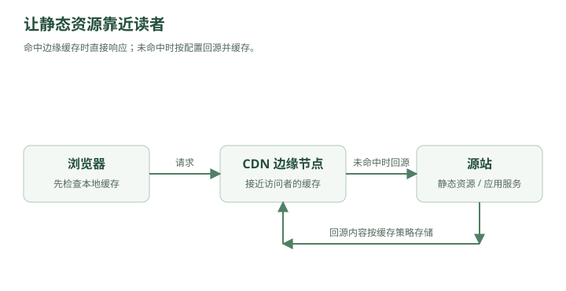

# 服务器明明没挂，为什么用户还是觉得“慢”？——DNS、CDN 与多地域访问

林默最近遇到了一个很奇怪的问题。

北京用户：

```text
打开首页：120ms
```

上海用户：

```text
180ms
```

广州用户：

```text
600ms
```

新加坡用户：

```text
1.3s
```

美国用户：

```text
2.4s
```

林默看服务器监控：

```text
CPU：22%
MySQL：正常
Redis：正常
MQ：正常
```

“系统又没过载，为什么国外用户这么慢？”

老周看了他一眼。

“因为你之前解决的，都是服务器里面的问题。”

“现在该解决——”

> **服务器和用户之间的问题了。**

---

## 一、用户访问网站，第一步到底发生了什么？

用户在浏览器里输入：

```text
www.example.com
```

林默下意识说：

“请求发送到服务器。”

老周：

“服务器 IP 是多少？”

林默停住了。

域名：

```text
www.example.com
```

并不是一个 IP 地址。

真正网络通信最终需要的是：

```text
203.0.113.10
```

所以用户访问网站之前，要先解决一个问题：

> **这个域名对应哪台服务器？**

这就是：

### DNS

Domain Name System。

---

## 二、DNS 可以理解成互联网的电话簿

你知道一个人的名字：

```text
林默
```

但打电话需要：

```text
138xxxxxxx
```

DNS 做的就是：

```text
www.example.com
        ↓
203.0.113.10
```

于是完整流程其实是：

```text
用户输入域名
   ↓
DNS 查询
   ↓
得到服务器 IP
   ↓
建立 TCP/QUIC 连接
   ↓
TLS 握手
   ↓
HTTP 请求
```

还没进入你的 Spring Boot，

前面已经走了很多步。

---

## 三、DNS 查询也不是直接问“互联网总部”

林默问：

“DNS 到底问谁？”

老周画：

```text
浏览器缓存
    ↓
操作系统缓存
    ↓
本地 DNS Resolver
    ↓
根 DNS
    ↓
顶级域 DNS
    ↓
权威 DNS
```

实际流程有缓存，不一定每次都走到底。

比如查询：

```text
www.example.com
```

如果浏览器已经缓存：

```text
www.example.com → 203.0.113.10
```

直接使用。

没有的话，再问系统或者 DNS Resolver。

---

## 四、TTL

DNS 结果不会永远缓存。

比如：

```text
TTL = 300 秒
```

意思是：

> 这条 DNS 解析结果可以缓存 5 分钟。

5 分钟后：

```text
重新查询
```

林默马上想到：

“那 TTL 设置长一点不是更快？”

“是。”

“那就设一年。”

老周：

“如果你换服务器 IP 呢？”

林默：

“……”

TTL 越长：

```text
DNS 查询更少
缓存效果更好
```

但是：

```text
变更生效更慢
```

TTL 越短：

```text
变更更灵活
```

但：

```text
DNS 查询更多
```

又一次取舍。

---

## 五、DNS 不只是“域名转 IP”

几个月后，公司有两个机房：

```text
北京机房
上海机房
```

北京用户访问：

```text
北京机房更近
```

上海用户：

```text
上海机房更近
```

DNS 完全可以根据：

```text
用户地理位置
网络运营商
服务健康状态
```

返回不同 IP。

例如：

```text
北京用户：
www.example.com
→ 北京 IP

上海用户：
www.example.com
→ 上海 IP
```

于是 DNS 开始承担：

### 流量调度

Traffic Steering。

这时候 DNS 已经不只是“电话簿”。

它还是：

> **互联网入口的导航系统。**

---

## 六、可是图片为什么还是慢？

系统已经能让用户访问比较近的机房。

但首页有：

```text
logo.png
banner.jpg
app.js
vendor.js
style.css
video.mp4
```

其中一个视频：

```text
100 MB
```

美国用户请求北京服务器：

```text
America
   ↓
太平洋海底光缆
   ↓
China
   ↓
Origin Server
```

光传播再快，也不能瞬移。

更别说中间还有：

```text
路由器
运营商
拥塞
丢包
跨境链路
```

老周问：

“一个静态图片，有必要每次都从北京传过去吗？”

林默突然明白了。

---

## 七、CDN 出现

老周画：



<details class="original-diagram" markdown="1">
<summary>查看文字版示意</summary>

```text
                 北京源站
                    ↑
                    │ 回源
              ┌─────┴─────┐
              │    CDN    │
              └─────┬─────┘
                    │
      ┌─────────────┼─────────────┐
      ▼             ▼             ▼
   东京节点      洛杉矶节点      新加坡节点
```

</details>

用户不再每次访问北京源站。

美国用户：

```text
用户
 ↓
洛杉矶 CDN 节点
```

日本用户：

```text
用户
 ↓
东京 CDN 节点
```

新加坡用户：

```text
用户
 ↓
新加坡 CDN 节点
```

这就是：

### CDN

Content Delivery Network。

内容分发网络。

---

## 八、CDN 的本质是什么？

林默：

“所以就是多放几台服务器？”

老周：

“可以这么理解，但关键在于——”

> **把内容放到离用户更近的地方。**

这个思想其实和 Redis 很像。

Redis：

```text
把数据库里的热点数据
放到离应用更近的内存
```

CDN：

```text
把源站里的静态内容
放到离用户更近的边缘节点
```

所以从本质上说：

> **CDN 是互联网边缘的大型缓存系统。**

---

## 九、第一次访问 CDN 会发生什么？

美国用户请求：

```text
/banner.jpg
```

洛杉矶 CDN 节点：

```text
本地没有
```

于是：

```text
CDN
 ↓
回源
 ↓
北京服务器
 ↓
获取 banner.jpg
 ↓
缓存到洛杉矶
 ↓
返回用户
```

这第一次可能还是慢。

但第二个美国用户：

```text
用户
 ↓
洛杉矶 CDN
 ↓
直接命中
```

不用再回北京。

这叫：

### Cache Hit

缓存命中。

如果没有：

### Cache Miss

然后：

### 回源

Origin Fetch。

---

## 十、为什么 CDN 能显著减少源站压力？

假设：

```text
banner.jpg
大小 = 5 MB
```

一百万用户访问。

没有 CDN：

```text
5 MB × 1,000,000
```

全部从源站发。

大约：

```text
5 TB
```

流量。

有 CDN：

每个边缘节点可能只需要：

```text
回源一次
```

之后用户都从 CDN 读。

源站的：

```text
带宽
连接数
CPU
```

压力大幅下降。

所以 CDN 不只是：

```text
让用户更快
```

还可以：

```text
保护源站
```

---

## 十一、静态资源为什么特别适合 CDN？

比如：

```text
logo.png
style.css
app.js
视频
安装包
```

特点：

```text
很多人读
内容很少变化
```

和 Redis 缓存热点数据一个逻辑：

> **读多写少，非常适合缓存。**

但动态 API：

```text
GET /api/account/balance
```

每个人结果不一样，而且实时变化。

这种东西不能简单在 CDN 缓很久。

所以典型架构：

```text
                ┌→ CDN → 图片/JS/CSS/视频
用户 ───────────┤
                └→ API Gateway → 动态业务
```

---

## 十二、前后端分离之后，这个结构尤其明显

前端打包出来：

```text
index.html
app.js
vendor.js
style.css
```

通常可以部署到：

```text
CDN / Object Storage
```

后端：

```text
api.example.com
```

进入：

```text
Gateway
↓
App
↓
Redis/MySQL
```

于是：

```text
静态内容
→ CDN

动态业务
→ 后端集群
```

两条路径彻底分开。

---

## 十三、缓存多久？

林默给所有 CDN 文件设置：

```text
Cache-Control: max-age=31536000
```

一年。

结果前端上线新版本。

用户刷新：

```text
还是旧 app.js
```

林默：

“完蛋。”

缓存最麻烦的问题再次出现：

> **内容变了，但是缓存没变。**

这和 Redis 一模一样。

---

## 十四、CDN 缓存一致性

比如：

```text
app.js
```

旧版本：

```text
v1
```

CDN 已经缓存。

现在源站更新成：

```text
v2
```

但 CDN 不知道。

在 TTL 到期前：

```text
用户仍然拿 v1
```

怎么办？

一种办法：

### CDN Purge

主动刷新/失效缓存。

告诉 CDN：

```text
/app.js
```

删掉。

下一次用户访问：

```text
重新回源
```

获取 v2。

---

## 十五、但是有一个更漂亮的办法：文件指纹

前端工程里常见：

```text
app.a81f2c.js
```

下一次发布：

```text
app.9c71ab.js
```

文件内容变化：

```text
文件名也变化
```

于是可以放心：

```text
Cache-Control: 1 year
```

因为新页面引用的是：

```text
app.9c71ab.js
```

这是一个全新的 URL。

CDN：

```text
没有缓存
↓
回源
↓
拿新版本
```

旧用户如果还访问：

```text
app.a81f2c.js
```

继续拿旧版本也没关系。

这叫：

### Cache Busting

缓存破坏 / 缓存版本化。

---

## 十六、这其实又是一个系统设计思想

不要总想着：

```text
“怎么让缓存实时更新？”
```

有时更简单的是：

> **让新内容使用一个新 Key。**

Redis 中也可以类似：

```text
user:9527:v1
user:9527:v2
```

CDN：

```text
app.hash1.js
app.hash2.js
```

很多缓存一致性问题，可以通过：

### Immutable Resource

不可变资源

来简化。

---

## 十七、HTML 为什么通常不能缓存一年？

因为：

```text
index.html
```

里面可能引用：

```html
<script src="app.9c71ab.js"></script>
```

如果 index.html 自己缓存一年，

用户一直拿旧 HTML：

```text
<script src="app.a81f2c.js"></script>
```

那新 JS 文件再漂亮也没用。

所以常见策略是：

```text
index.html
→ 短缓存 / 不缓存

带 hash 的 JS/CSS
→ 长缓存
```

这是现代 Web 前端很重要的缓存设计。

---

## 十八、ETag 又是什么？

林默问：

“如果文件没变，但 TTL 到期了，是不是必须重新下载？”

不一定。

浏览器可以发送：

```http
If-None-Match: "abc123"
```

服务器检查：

```text
文件还是 abc123
```

返回：

```http
304 Not Modified
```

意思：

> “没变，你继续用本地的。”

不用重新传整个文件。

`ETag` 可以理解成：

```text
文件版本指纹
```

类似还有：

```text
Last-Modified
```

客户端问：

```text
从上次修改以后变了吗？
```

服务器：

```text
没变
→ 304
```

---

## 十九、浏览器缓存和 CDN 缓存不是一回事

林默整理：

```text
Browser Cache
```

缓存发生在：

```text
用户自己的设备
```

而：

```text
CDN Cache
```

发生在：

```text
离用户较近的 CDN 边缘服务器
```

整体链路：

```text
浏览器
 ↓
浏览器缓存？
 ↓ Miss
CDN
 ↓
CDN 缓存？
 ↓ Miss
源站
```

因此实际 Web 系统可能有多层缓存：

```text
Browser Cache
↓
CDN Cache
↓
Nginx Cache
↓
Redis
↓
MySQL
```

这就是：

### Multi-Level Cache

多级缓存。

---

## 二十、多级缓存为什么快？

假设：

```text
浏览器缓存命中
```

甚至网络请求都不用发。

最快。

浏览器没有：

```text
CDN 命中
```

可能十几毫秒。

CDN 没有：

```text
源站 Redis 命中
```

几十毫秒。

再没有：

```text
MySQL
```

更慢。

所以：

```text
越靠近用户
↓
越快
```

又回到了第二章那个规律：

> **热门数据应该尽量靠近使用它的人。**

---

## 二十一、但是 CDN 节点自己挂了怎么办？

比如洛杉矶节点故障。

如果 DNS 还把用户：

```text
全部指向洛杉矶节点
```

那就麻烦了。

所以成熟 CDN 会做：

```text
健康检查
```

如果节点异常：

```text
洛杉矶节点 ❌
```

流量可以调度到：

```text
旧金山节点
```

或者：

```text
西雅图节点
```

用户甚至可能感觉不到。

这已经开始进入：

### Global Traffic Management

全球流量调度。

---

## 二十二、系统有多个机房之后会发生什么？

公司越来越大。

部署：

```text
北京 Region
上海 Region
新加坡 Region
美国 Region
```

现在用户：

```text
中国用户
→ 中国 Region

东南亚用户
→ 新加坡 Region

美国用户
→ 美国 Region
```

这叫：

### Multi-Region Deployment

多地域部署。

好处不仅是速度。

还有：

### 容灾

如果整个北京机房挂了：

```text
北京 Region ❌
```

可以把流量切到：

```text
上海 Region
```

系统仍然可以继续运行。

---

## 二十三、可是数据库怎么办？

林默忽然发现事情又复杂了。

App 放多个 Region 很容易。

例如：

```text
Beijing App
Singapore App
US App
```

但所有地方都访问北京 MySQL：

```text
US App
↓
跨太平洋
↓
Beijing MySQL
```

还是慢。

那是不是：

```text
每个 Region 都放 MySQL？
```

比如：

```text
Beijing DB
Singapore DB
US DB
```

老周：

“可以。”

林默：

“那它们怎么保持一致？”

老周笑了。

熟悉的噩梦又回来了。

---

## 二十四、多地域真正难的是数据

静态资源：

```text
复制到全世界
```

很简单。

因为主要是读。

但动态数据：

```text
余额
订单
库存
聊天消息
```

可能不断修改。

比如用户在美国修改昵称：

```text
US DB：新昵称
```

北京用户马上查询：

```text
Beijing DB
```

它什么时候能看到？

这就再次回到：

```text
复制延迟
一致性
冲突
```

只不过现在延迟不再是：

```text
同一个机房几毫秒
```

而可能是：

```text
跨洲几十到几百毫秒
```

于是：

> **多地域系统设计，真正难的不是部署服务，而是数据一致性。**

---

## 二十五、Active-Passive

一种相对简单的方案：

```text
北京 Region
→ Active

上海 Region
→ Passive
```

平时所有业务：

```text
北京处理
```

上海：

```text
同步数据
等待
```

北京整个挂掉：

```text
流量切上海
```

这叫：

### Active-Passive

主备模式。

优点：

```text
架构相对简单
数据冲突少
```

缺点：

```text
备用资源平时利用率低
故障切换可能需要时间
```

---

## 二十六、Active-Active

更进一步：

```text
北京 Region
→ 接流量

上海 Region
→ 也接流量
```

这叫：

### Active-Active

双活 / 多活。

资源利用更充分。

用户也能就近访问。

但难度瞬间提高。

比如：

北京：

```text
用户把昵称改成 A
```

上海同时：

```text
用户把昵称改成 B
```

最后到底是什么？

```text
A？
B？
```

需要：

```text
冲突解决
```

支付、库存更麻烦。

所以：

> **多活不是“再部署一套服务器”这么简单。**

核心难点是：

```text
写冲突
一致性
复制
故障恢复
```

---

## 二十七、RPO 和 RTO

这时候老周第一次让林默记两个真正重要的指标。

### RPO

Recovery Point Objective。

问的是：

> **最多允许丢多少数据？**

比如：

```text
RPO = 0
```

意味着：

```text
一条数据都不能丢
```

RPO：

```text
5 分钟
```

表示灾难发生时：

```text
最多接受丢最近 5 分钟的数据
```

---

## 二十八、RTO

Recovery Time Objective。

问的是：

> **挂了以后，最多多久必须恢复？**

比如：

```text
RTO = 30 秒
```

那么机房挂了：

```text
30 秒内
```

业务必须恢复。

如果：

```text
RTO = 4 小时
```

那要求就低很多。

所以：

```text
RPO
→ 可以丢多少数据

RTO
→ 可以停多久
```

非常好记。

---

## 二十九、为什么 RPO=0、RTO=0 很贵？

老板：

> “我要求任何情况下不丢一条数据，而且 0 秒恢复。”

架构师：

> “预算呢？”

因为做到：

```text
RPO ≈ 0
RTO ≈ 0
```

需要非常昂贵的：

```text
同步多副本
多机房
自动故障检测
自动流量切换
持续演练
复杂数据库架构
```

所以高可用仍然不是：

> 越高越好。

而是：

> **根据业务价值决定花多少钱买可用性。**

---

## 三十、99.9% 和 99.99% 到底差多少？

老周写：

```text
99.9%
```

一年允许不可用大约：

```text
8.76 小时
```

而：

```text
99.99%
```

一年大约：

```text
52.6 分钟
```

再到：

```text
99.999%
```

一年大约：

```text
5.26 分钟
```

每增加一个 `9`：

```text
系统复杂度
和
成本
```

通常都会显著上升。

这就是：

### Availability

可用性。

---

## 三十一、可是“服务器返回 200”就算可用吗？

林默说：

“只要服务没挂就是可用？”

老周：

“如果用户请求花 30 秒才返回呢？”

“……”

“如果首页打开了，但是支付全挂呢？”

“……”

所以真正的可用性不只是：

```text
进程还活着
```

而应该是：

> **用户能在可接受时间内完成关键业务。**

这也是为什么监控不能只看：

```text
CPU
Memory
```

还要看：

```text
成功率
错误率
P95/P99 延迟
关键业务成功率
```

---

## 三十二、平均延迟会骗人

监控：

```text
平均延迟：100ms
```

林默：

“很快啊。”

老周：

“看 P99。”

```text
P99：8 秒
```

意思是：

```text
99% 请求 ≤ 8 秒
```

更准确一点：

> 排序后，99% 请求的延迟不超过这个值。

虽然大部分用户很快，

但最慢的那部分用户体验极差。

所以大型系统特别关注：

```text
P95
P99
P99.9
```

而不仅仅：

```text
Average
```

因为平均值可能被大量快速请求“稀释”。

---

## 三十三、长尾延迟

假设 100 个请求：

```text
99 个请求：50ms
1 个请求：5s
```

平均：

```text
≈ 99.5ms
```

看起来：

```text
不到 100ms
```

非常漂亮。

但那个用户真的等了：

```text
5 秒
```

这就是：

### Tail Latency

长尾延迟。

系统越复杂，调用链越长：

```text
A
↓
B
↓
C
↓
D
↓
E
```

只要某一个下游偶尔慢一下，

整个请求就可能进入长尾。

所以：

> **系统设计不仅要优化平均情况，还要优化最坏的那部分用户。**

---

## 三十四、现在整个请求终于可以完整走一遍了

一个美国用户打开商城。

第一步：

```text
www.example.com
```

DNS：

```text
找到离用户更合适的入口
```

然后：

```text
HTML / JS / CSS / 图片
↓
CDN
```

大部分静态资源直接从附近边缘节点返回。

动态请求：

```text
/api/orders
```

进入：

```text
最近 Region
↓
Gateway
↓
Rate Limiter
↓
App
↓
Redis
↓
DB / MQ
```

如果某个 Region 故障：

```text
DNS / Global LB
↓
切换其他 Region
```

到这里，我们最开始那台：

```text
Spring Boot + MySQL
```

已经彻底长成了一个分布式系统。

---

## 三十五、从第一章到现在，其实一直只有几个问题

林默把前六章和这一章全部画在一起。

### 用户越来越多

```text
一台 App 不够
↓
负载均衡
↓
水平扩展
```

### 状态无法共享

```text
Session
↓
Redis
↓
无状态服务
```

### 数据库读压力

```text
主从
↓
读写分离
```

### 数据库容量和写能力

```text
分库分表
```

### 瞬时流量

```text
MQ
↓
削峰
```

### 系统过载

```text
限流
```

### 下游故障

```text
超时
熔断
降级
隔离
```

### 用户离服务器太远

```text
CDN
多地域部署
```

老周说：

> “你看起来学了几十个技术名词。”

> “其实一直在解决几个非常朴素的问题。”

---

## 三十六、系统设计真正的六个问题

林默最后总结成：

```text
1. 请求太多怎么办？
2. 数据太多怎么办？
3. 某台机器挂了怎么办？
4. 某个服务变慢怎么办？
5. 数据不一致怎么办？
6. 用户离服务器太远怎么办？
```

几乎所有常见系统设计技术，

都可以塞回这六个问题。

例如：

```text
Load Balancer
→ 请求太多
```

```text
Sharding
→ 数据太多
```

```text
Replica
→ 机器挂了
```

```text
Circuit Breaker
→ 服务变慢/失败
```

```text
Outbox / Consensus
→ 数据一致性
```

```text
CDN / Multi-Region
→ 用户太远
```

到这里，你已经不应该再把系统设计看成：

> “背一堆组件。”

而应该开始看成：

> **发现瓶颈 → 找出约束 → 做取舍 → 引入新组件 → 接受它带来的新问题。**

---

## 第七章结束

这一章需要真正记住的因果链是：

```text
服务器本身没问题
↓
用户仍然慢
↓
发现网络距离也是成本
↓
DNS
↓
就近流量调度
↓
静态资源仍然跨地域传输
↓
CDN
↓
边缘缓存
↓
Cache Hit / Miss / 回源
↓
缓存一致性
↓
Cache-Control / ETag / 文件 Hash
↓
多地域部署
↓
Region 故障转移
↓
Active-Passive / Active-Active
↓
RPO / RTO
↓
可用性
↓
P95 / P99 / 长尾延迟
```

下一章，我们可以正式进入系统设计里最容易把人绕晕、但也是最核心的一块：

### 下一章：两个数据库都说自己是真的——CAP、一致性与分布式共识

会从一次真正的**网络分区事故**开始，一步步讲：

**强一致性、最终一致性、CAP 到底在说什么、为什么网络分区无法避免、CP/AP 怎么选、Quorum、Leader、Raft 的基本直觉、脑裂、分布式锁为什么会失效，以及为什么“多副本”远没有想象中简单。**

> **工程补充**：DNS 缓存、健康检查周期和客户端连接会影响实际切换时间。CDN 故障转移与多地域容灾都需要预留容量，并验证数据恢复点（RPO）和恢复时间（RTO）。


