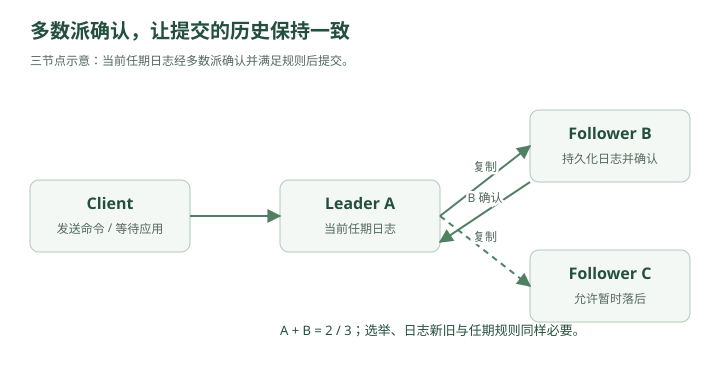

# 两个数据库都说自己是真的——CAP、一致性与分布式共识

凌晨两点。

北京机房和上海机房之间的专线突然抖了一下。

最开始没人注意。

因为：

```text
北京 Region：正常
上海 Region：正常
```

两边机器都活着。

CPU 正常。

数据库正常。

应用正常。

但是很快，报警出现：

```text
Beijing → Shanghai timeout
Shanghai → Beijing timeout
```

林默盯着屏幕。

“机器都没挂，为什么系统报警？”

老周看了一眼。

“因为这次不是机器坏了。”

“是它们——”

> **彼此听不见了。**

---

## 一、什么叫网络分区？

原本：

```text
Beijing DB
   │
   │ 网络正常
   │
Shanghai DB
```

现在：

```text
Beijing DB

   X

Shanghai DB
```

两边机器其实都活着。

只是网络断开。

这叫：

### Network Partition

网络分区。

也可以理解为：

> 一个分布式系统被网络切成了两个彼此无法通信的岛。

这件事情非常危险。

因为两边都会想：

```text
“我还活着。”
```

而且它们不知道：

```text
“对方到底是挂了，
还是只是网络断了？”
```

---

## 二、分布式系统最烦人的地方：你无法区分“挂了”和“没回消息”

林默说：

“那我 ping 一下不就知道了？”

老周摇头。

假设：

```text
A → B
```

请求 1 秒没有回应。

可能原因：

```text
B 挂了
网络断了
网络拥塞
B 很忙
GC Stop-The-World
磁盘卡住
线程池满了
```

A 看到的只有：

```text
timeout
```

它无法百分之百知道到底是哪一种。

这就是分布式系统一个非常根本的问题：

> **没有回应，不等于对方已经死亡。**

---

## 三、事故真正开始了

公司的用户资料系统做了双 Region。

北京：

```text
User DB A
```

上海：

```text
User DB B
```

正常时：

```text
A ↔ B
```

不断同步。

网络分区之后：

```text
A    X    B
```

这时北京用户把昵称改成：

```text
Alpha
```

上海用户同时把昵称改成：

```text
Beta
```

北京数据库说：

```text
name = Alpha
```

上海数据库说：

```text
name = Beta
```

网络恢复之后，两边一见面：

```text
A：我是 Alpha
B：我是 Beta
```

谁是真的？

林默沉默了。

---

## 四、这就是一致性问题

如果系统有一个副本：

```text
只有 A
```

那么世界很简单。

数据就是：

```text
A 里面是什么
就是什么
```

但一旦有多个副本：

```text
A
B
C
```

就必须回答：

> **多个副本看到的数据，应该保持到什么程度的一致？**

这就是：

### Consistency

一致性。

---

## 五、最理想的情况：强一致性

林默说：

“那就要求所有节点永远一样。”

老周：

“这就是强一致性的直觉。”

比如用户把余额：

```text
1000
```

改成：

```text
900
```

如果写成功，

之后任何节点读取，都必须看到：

```text
900
```

而不能有人看到：

```text
1000
```

这类保证可以粗略理解为：

### Strong Consistency

强一致性。

更严格的分布式语义里，还会讨论：

```text
Linearizability
```

线性一致性。

它要求系统表现得像：

> 所有操作仿佛在一台机器上按某个全局顺序瞬间发生。

---

## 六、线性一致性的直觉

假设：

```text
t1：A 写 x = 10
t2：写操作返回成功
t3：B 读 x
```

如果：

```text
t3 > t2
```

那么 B 必须读到：

```text
10
```

不能读：

```text
旧值
```

因为对用户来说：

```text
“这个写操作已经成功结束了。”
```

之后的读取就应该看到它。

这就是一种非常强的语义。

---

## 七、但强一致性要付出代价

现在北京和上海之间网络断了。

北京用户要写：

```text
x = 10
```

如果要求强一致，

北京必须确认：

```text
上海也同步好了
```

才能告诉用户：

```text
写成功
```

可问题是：

```text
北京根本联系不上上海
```

怎么办？

只有两个选择。

---

## 八、选择一：拒绝服务

北京：

```text
“联系不上上海，
我不能保证一致性。”
```

于是：

```text
写请求失败
```

甚至部分读请求也可能失败。

系统保持：

```text
一致
```

但牺牲：

```text
可用性
```

---

## 九、选择二：继续服务

北京：

```text
“算了，上海联系不上，
我先自己写。”
```

上海也这么想。

于是：

```text
北京：x = 10
上海：x = 20
```

两边用户都得到：

```text
成功
```

系统保持：

```text
可用
```

但：

```text
数据不一致
```

网络恢复之后还得解决冲突。

---

## 十、CAP 正式出现

老周终于在白板写下：

```text
C
A
P
```

### CAP Theorem

CAP 定理。

分别是：

```text
C = Consistency
A = Availability
P = Partition Tolerance
```

---

## 十一、先理解 P

P：

### Partition Tolerance

分区容错性。

意思是：

> 即使节点之间的网络出现分区，系统仍然必须能够按照某种方式继续处理。

在真正的分布式系统里：

```text
网络故障
```

是无法彻底消灭的。

所以通常：

> **P 不是“要不要选”的问题。**

而是：

```text
网络分区发生时，
你在 C 和 A 之间怎么取舍？
```

这才是 CAP 真正想表达的东西。

---

## 十二、CAP 不是“平时三选二”

这是非常常见的误解。

很多人背：

> CAP 三者只能选两个。

然后说：

```text
CA
CP
AP
```

但现实中更准确的理解是：

> **当网络分区发生时，你无法同时保证强一致性和可用性。**

因为正常情况下没有 Partition：

```text
网络正常
```

你当然可能同时获得：

```text
一致性
+
可用性
```

真正的矛盾发生在：

```text
P 出现时
```

---

## 十三、CP 系统

如果发生网络分区：

```text
A    X    B
```

系统选择：

> **宁愿拒绝一部分请求，也不能产生不一致数据。**

这就是偏：

### CP

Consistency + Partition Tolerance。

比如某个关键写操作：

```text
不能确认多数节点
↓
拒绝写入
```

优点：

```text
数据更可信
```

缺点：

```text
网络异常时可能不可用
```

---

## 十四、AP 系统

另一种思路：

即使：

```text
A    X    B
```

两边也继续服务。

北京可以写。

上海也可以写。

这就是偏：

### AP

Availability + Partition Tolerance。

优点：

```text
系统尽量可用
```

缺点：

```text
短时间可能不一致
```

等网络恢复：

```text
再合并
```

最终达到：

### Eventual Consistency

最终一致性。

---

## 十五、到底什么时候选 CP，什么时候选 AP？

林默问：

“那哪个更好？”

老周：

“看业务。”

例如：

### 银行扣款

如果两个 Region 都认为余额：

```text
100
```

北京花：

```text
80
```

上海同时花：

```text
80
```

两个地方都成功：

```text
总共花 160
```

显然不行。

这种场景通常更偏向：

```text
一致性优先
```

---

### 社交点赞数

北京：

```text
1001
```

上海：

```text
1003
```

几十毫秒或几秒不一致，

很多时候问题不大。

这种场景可以更偏：

```text
可用性
```

---

## 十六、这就是系统设计中的关键思想

不是：

```text
“我要强一致。”
```

或者：

```text
“我要最终一致。”
```

而是：

> **哪部分业务需要什么级别的一致性？**

例如：

```text
余额
库存扣减
支付状态
→ 一致性要求高
```

```text
点赞数
浏览量
推荐结果
在线人数
→ 可以弱一些
```

不要对整个系统统一使用最强一致性。

否则：

```text
协调成本与复杂度上升
延迟可能增加
分区期间的可用性可能下降
```

都需要重新权衡。

---

## 十七、那多个副本怎么决定谁是真的？

林默回到最初的问题。

如果三个节点：

```text
A
B
C
```

谁说了算？

老周：

“最常见的一个思路——多数派。”

### Quorum

法定人数 / 多数派。

比如三个节点：

```text
A
B
C
```

多数是多少？

```text
2
```

如果一个值被：

```text
2 个节点
```

按照同一协议和版本规则确认，

才可能把它认定为已提交。不能只数相同值的副本数量，就推断已经获得一致性。

---

## 十八、为什么多数派有用？

假设：

```text
A B
```

认为：

```text
x = 10
```

而：

```text
C
```

认为：

```text
x = 9
```

因为：

```text
A + B = 2
```

是多数。

所以：

```text
x = 10
```

可以被认为是当前有效状态。

更重要的是：

两个多数派集合一定会有交集。

三节点中：

```text
任意 2 个节点
```

形成多数派。

两个多数派不可能完全不重叠。

例如：

```text
{A,B}
{B,C}
```

一定至少共享：

```text
B
```

这给一致性提供了基础。交集本身还不够，必须结合版本、投票限制、日志新旧比较和提交规则，才能排除冲突历史。

---

## 十九、五个节点呢？

```text
A B C D E
```

多数：

```text
3
```

只要：

```text
3 个节点
```

还能通信，

系统就可以继续达成多数决策。

所以五节点集群可以容忍：

```text
2 个节点失败
```

而仍然保留多数。

一般来说：

```text
2f + 1 个节点
```

可以容忍：

```text
f 个故障
```

前提是它们只是故障/失联，不涉及拜占庭恶意行为。

---

## 二十、但谁负责协调写入？

老周又画：

```text
A
B
C
```

如果三个节点都能随便接受写：

```text
A：x=1
B：x=2
C：x=3
```

冲突很多。

一种经典办法：

> **选一个 Leader。**

```text
       Leader A
       /      \
      B        C
   Follower Follower
```

所有写：

```text
Client
 ↓
Leader
```

Leader 再复制给 Followers。

这和 MySQL 主从有点像。

但这里会进一步解决：

```text
Leader 是谁？
Leader 挂了怎么办？
多个节点都觉得自己是 Leader 怎么办？
日志顺序怎么统一？
```

这就进入：

### Consensus

分布式共识。

---

## 二十一、共识到底是什么？

一句话：

> **让多个互不完全可靠的节点，对某件事情达成一致。**

例如：

```text
谁是 Leader？
```

或者：

```text
第 100 条日志到底是什么？
```

或者：

```text
x 最终应该等于多少？
```

这类问题都属于共识问题。

---

## 二十二、Raft 登场

老周说：

“先不碰证明，先理解 Raft 的直觉。”

Raft 里节点主要有三个状态：

```text
Follower
Candidate
Leader
```

正常情况下：

```text
        Leader
       /      \
Follower    Follower
```

只有一个 Leader。

Leader 定期发送：

```text
Heartbeat
```

告诉大家：

```text
“我还活着。”
```

---

## 二十三、Leader 挂了怎么办？

比如：

```text
Leader A
```

突然宕机。

Followers：

```text
B
C
```

一段时间没收到心跳。

其中一个节点：

```text
B
```

开始想：

> “Leader 好像死了，我来竞选。”

于是变成：

### Candidate

然后：

```text
B → 请求投票
```

如果获得多数票：

```text
B 成为新 Leader
```

架构变成：

```text
        Leader B
       /      \
     A?        C
```

A 恢复后发现：

```text
“现在 Leader 已经是 B。”
```

自己退回 Follower。

---

## 二十四、为什么需要 Term？

如果只是简单选举，很容易混乱。

Raft 把时间切成：

### Term

任期。

例如：

```text
Term 1：A 是 Leader
Term 2：B 是 Leader
Term 3：C 是 Leader
```

每次重新选举：

```text
Term + 1
```

这样节点就可以判断：

```text
“你的信息是旧任期的，
不算。”
```

比如：

```text
A：我是 Term 5 Leader
B：我是 Term 7 Leader
```

那么：

```text
A 的身份已经过期
```

这对解决旧 Leader 恢复后的混乱非常关键。

---

## 二十五、日志复制

客户端发送：

```text
SET x = 10
```

不是 Leader 自己写完就算成功。

典型流程可以粗略理解为：



<details class="original-diagram" markdown="1">
<summary>查看文字版示意</summary>

```text
Client
 ↓
Leader
 ↓
写入本地日志
 ↓
复制给 Followers
 ↓
多数节点确认
 ↓
Commit
 ↓
返回成功
```

</details>

比如：

```text
A Leader
B Follower
C Follower
```

A 收到：

```text
x = 10
```

A 自己有。

B 也确认。

此时：

```text
2/3
```

多数。

对于当前任期的日志条目，在满足 Raft 提交规则后，就可以推进提交位置。旧任期日志不能仅靠副本计数直接提交，通常要通过提交当前任期条目来间接提交之前的日志；客户端成功响应还应等状态机应用该命令。

哪怕 C 暂时慢一点，

也不影响。

---

## 二十六、为什么不是等所有节点？

如果要求：

```text
A
B
C
```

全部确认，

那 C 只要卡住：

```text
整个系统都不能写
```

可用性太差。

所以多数派是一个经典折中：

```text
不用等所有
但也不能只有自己
```

在：

```text
一致性
可用性
故障容忍
```

之间找到平衡。

---

## 二十七、Raft 和主从复制有什么区别？

林默问：

“这和上一章的主从不是很像吗？”

“表面很像。”

区别在于传统异步主从可能主要关注：

```text
复制
```

而共识协议还需要严格解决：

```text
Leader 选举
日志顺序
提交规则
节点故障
网络分区
旧 Leader 恢复
```

目标是：

> **保证多个节点对操作顺序达成一致。**

所以：

```text
复制 ≠ 共识
```

复制只是：

```text
把数据拷过去
```

共识还需要决定：

```text
“哪个版本才是合法历史？”
```

---

## 二十八、脑裂

网络突然分成：

```text
A B
```

和：

```text
C
```

如果 C 觉得：

```text
“A 和 B 都死了，我当 Leader。”
```

而 A 也觉得：

```text
“C 死了，我继续当 Leader。”
```

那系统出现：

```text
Leader A
+
Leader C
```

这叫：

### Split Brain

脑裂。

两个节点都认为自己有资格写。

于是：

```text
A 接受订单 1
C 接受订单 2
```

网络恢复：

```text
两套历史冲突
```

非常危险。

---

## 二十九、多数派为什么能防脑裂？

三节点：

```text
A B C
```

网络分成：

```text
A B
```

和：

```text
C
```

A+B：

```text
2 个
```

拥有多数。

C：

```text
1 个
```

没有多数。

所以：

```text
A/B 一侧可以选 Leader
C 一侧不能成为合法 Leader
```

于是只有能够取得多数派确认的一侧可以继续提交新写入。隔离的旧 Leader 可能暂时仍自认为是 Leader，但无法提交；线性一致读也需要 ReadIndex 等确认机制或满足假设的租约机制，不能直接读任意旧副本。

这就是 Quorum 的重要价值。

---

## 三十、那为什么偶数节点通常没那么划算？

假设：

```text
4 个节点
```

多数：

```text
3
```

能容忍：

```text
1 个失败
```

而：

```text
3 个节点
```

多数：

```text
2
```

也能容忍：

```text
1 个失败
```

所以：

```text
4 台
```

相比：

```text
3 台
```

并没有多获得一份故障容忍能力。

只是多了一台机器。

因此很多共识集群常见：

```text
3
5
7
```

这类奇数节点。

当然实际部署还要考虑性能和拓扑，不是“永远只能奇数”。

---

## 三十一、分布式锁开始出问题了

林默突然想起之前 Redis 做的分布式锁。

比如：

```text
SET lock:order123 ownerA NX EX 10
```

A 获取锁。

然后开始处理订单。

锁 TTL：

```text
10 秒
```

但某次 A 发生长时间 GC。

暂停：

```text
15 秒
```

锁已经过期。

B 来了。

获取成功：

```text
lock → ownerB
```

B 开始处理。

这时 A 从 GC 中恢复。

A 还以为：

```text
“我拿着锁。”
```

于是：

```text
A 和 B
```

同时操作资源。

分布式锁失效了。

---

## 三十二、为什么“拿到锁”不代表你永远有资格操作？

因为分布式世界里：

```text
时间
网络
进程暂停
```

都会出问题。

A 获取锁时：

```text
合法
```

10 秒后：

```text
锁已经过期
```

但 A 自己并不知道。

所以真正危险的不是：

```text
两个人同时抢锁
```

而是：

> **旧持有者恢复后继续执行。**

这叫：

### Stale Owner

过期持有者。

---

## 三十三、Fencing Token

老周给出一个更可靠的思路。

每次获取锁，

不仅得到：

```text
success
```

还得到一个递增编号：

```text
Token 101
```

下一次：

```text
Token 102
```

再下一次：

```text
103
```

假设：

```text
A → token 101
```

A 卡住。

锁过期。

B 获取：

```text
token 102
```

B 去写数据库或存储时：

```text
携带 token 102
```

底层记录：

```text
latest_token = 102
```

之后 A 恢复，

携带：

```text
token 101
```

底层发现：

```text
101 < 102
```

直接拒绝。

这就是：

### Fencing Token

栅栏令牌。

> **工程补充**：令牌应由具有相应一致性保证的机制单调生成，受保护资源必须原子地校验令牌并完成写入。只携带一个数字、只做续租，或者只在应用侧检查，都不足以实现隔离；去重和重试规则也要单独设计。

它不是阻止旧客户端醒来，

而是：

> **即使旧客户端醒来，也不给它继续修改资源的资格。**

---

## 三十四、这比“锁”更接近问题本质

很多人讨论分布式锁时只关注：

```text
如何加锁
如何续期
如何释放
```

但更深一层的问题是：

> **如何确保过期持有者不能破坏最新状态？**

所以在真正严格的一致性场景里，

单纯：

```text
Redis NX + TTL
```

可能并不足够。

还需要：

```text
版本号
fencing token
CAS
共识存储
```

等更严格的机制。

---

## 三十五、版本号与乐观锁

例如数据库里：

```text
balance = 100
version = 5
```

A 读取：

```text
100, version 5
```

B 也读取：

```text
100, version 5
```

A 更新：

```sql
UPDATE account
SET balance = 80,
    version = 6
WHERE id = 1
  AND version = 5;
```

成功。

B 再更新：

```sql
WHERE version = 5
```

此时数据库已经：

```text
version = 6
```

所以：

```text
更新 0 行
```

B 知道：

```text
“我的数据旧了。”
```

这就是：

### Optimistic Lock

乐观锁。

本质依然是：

> **不允许旧版本覆盖新版本。**

---

## 三十六、CAS

这个思想可以抽象成：

### Compare And Set

比较并设置。

意思是：

```text
只有当前值仍然是我预期的值
我才更新
```

例如：

```text
if version == 5:
    set version = 6
```

如果已经变成：

```text
6
```

说明别人先动了。

那我不能直接覆盖。

CAS 是很多并发控制机制的基础思想。

---

## 三十七、一致性不是只有“强”和“最终”两档

老周继续写：

```text
Strong Consistency
Eventual Consistency
```

中间其实还有很多语义。

例如：

### Read Your Writes

自己刚写的数据，

自己之后一定能看到。

---

### Monotonic Reads

如果你已经看到：

```text
version 10
```

以后不能又看到：

```text
version 8
```

也就是：

> 读取不能倒退。

---

### Monotonic Writes

同一个客户端的写入：

```text
A
↓
B
↓
C
```

必须按顺序生效。

不能：

```text
C 先于 B
```

---

### Causal Consistency

如果事件 B 因为事件 A 才发生，

其他人看到 B 时，

也应该看到 A。

比如：

```text
A：用户发帖
B：别人回复这条帖子
```

如果你看到了回复 B，

却看不到原帖 A，

体验会很诡异。

这就是：

### 因果一致性

---

## 三十八、所以系统设计里的“一致性”要问清楚

面试官说：

> “这个系统要保证一致性。”

不能就开始讲 CAP。

应该先问：

```text
什么数据？
什么操作？
需要多强？
允许多大延迟？
网络分区时还能不能拒绝写？
```

因为：

```text
余额
```

和：

```text
点赞数
```

根本不是一回事。

---

## 三十九、CAP 和数据库事务 ACID 的 C 不是同一个 C

这也是一个高频误区。

CAP：

```text
C = Consistency
```

这里讨论的是：

> 多副本之间观察到的数据一致性。

ACID：

```text
A = Atomicity
C = Consistency
I = Isolation
D = Durability
```

ACID 的 Consistency 更偏：

> 事务执行前后，数据库满足定义好的约束和合法状态。

例如：

```text
余额不能违反业务约束
外键必须满足
```

它们不是同一个概念。

面试里混在一起会很危险。

---

## 四十、BASE

林默又看到一个词：

### BASE

它通常和强事务系统形成对照。

可以粗略记：

```text
Basically Available
Soft State
Eventual Consistency
```

核心思想：

> 分布式系统有时为了可用性和扩展性，允许短暂不一致，最终再收敛。

比如：

```text
点赞
关注数
消息统计
推荐特征
```

就很常见。

这不是说：

```text
BASE = 不管数据
```

而是：

> **一致性策略更灵活。**

---

## 四十一、一次完整的网络分区推演

老周说：

“来，假设有三个节点。”

```text
A
B
C
```

A 是 Leader。

正常：

```text
A ↔ B
A ↔ C
```

突然网络分区：

```text
A

X

B ↔ C
```

A 单独一边。

B+C 一边。

林默：

“A 还是原 Leader。”

“对，但它只有 1 个节点。”

新写请求来到 A。

A 自己写成功。

但无法获得：

```text
多数确认
```

所以：

```text
不能 Commit
```

不能告诉用户成功。

---

另一边：

```text
B + C
```

一段时间收不到 A 心跳。

开始选举。

B 获得：

```text
B + C
```

多数票。

于是：

```text
B 成为新 Leader
```

之后客户端写 B：

```text
B
↓
复制给 C
↓
2/3 多数
↓
提交
```

所以真正合法历史继续在：

```text
B+C
```

这一侧发展。

网络恢复以后：

```text
A
```

发现自己任期已经旧了。

退回 Follower。

未提交的旧日志会被新 Leader 的合法日志覆盖/修正。

这就是共识协议最迷人的地方：

> **不是保证所有节点永远不出错，而是保证系统最终只有一条被认可的历史。**

---

## 四十二、林默终于理解“共识”的含义了

共识不是：

```text
所有机器永远一样
```

而是：

> 即使经历宕机、延迟、网络分区、重新选主，系统仍然能决定哪些操作是真正提交过的。

这也是为什么：

```text
etcd
ZooKeeper
Consul
```

这类系统经常被用在：

```text
配置
服务发现
Leader Election
分布式协调
元数据
```

因为这些事情最怕：

```text
“大家各说各话。”
```

---

## 四十三、那为什么不能所有数据都放进 Raft？

林默：

“既然 Raft 这么靠谱，那所有业务数据都强一致不就完了？”

老周：

“性能。”

每个写请求可能需要：

```text
Leader
↓
网络复制
↓
多数确认
↓
Commit
```

如果节点跨 Region：

```text
北京
新加坡
美国
```

一次写延迟至少受制于：

```text
网络 RTT
```

你想要：

```text
全球强一致
+
低延迟
+
高可用
```

通常非常困难。

所以现实系统经常：

```text
关键元数据
→ 强一致

大规模普通业务数据
→ 分区 + 最终一致

部分高价值数据
→ 单 Region 强一致
```

分层处理。

---

## 四十四、系统设计真正开始进入“取舍”

现在林默已经不再问：

```text
“哪个架构最好？”
```

而会问：

```text
这个业务最怕什么？
```

如果最怕：

```text
数据错
```

那就牺牲一些：

```text
可用性 / 延迟
```

如果最怕：

```text
服务不可用
```

那就允许：

```text
短暂不一致
```

如果两者都很重要：

那就需要：

```text
更复杂架构
+
更多资源
+
更高成本
```

不存在免费午餐。

---

## 四十五、这一章真正应该形成的直觉

老周最后在白板上写下：

```text
单机世界：
只有一个真相
```

```text
分布式世界：
可能同时出现多个“真相”
```

所以你需要：

```text
Leader
Quorum
Version
Consensus
Conflict Resolution
```

来回答：

> **谁才是真的？**

这就是分布式系统和普通 CRUD 最大的区别之一。

---

## 第八章结束

这一章的完整因果链是：

```text
多副本
↓
网络分区
↓
多个节点可能看到不同数据
↓
一致性问题
↓
CAP
↓
网络分区下 C 与 A 的取舍
↓
CP / AP
↓
Quorum
↓
Leader
↓
共识
↓
Raft
↓
Term / Election / Log Replication
↓
脑裂
↓
多数派阻止双 Leader
↓
分布式锁仍可能出现旧持有者
↓
Fencing Token
↓
Version / CAS / 乐观锁
↓
不同业务选择不同一致性模型
```

如果面试官问：

> **“CAP 为什么不能三个都要？”**

现在可以这样回答：

> 当网络分区发生时，不同节点无法通信。如果仍要求所有请求都可用，那么不同分区只能独立处理请求，这可能造成数据不一致；如果要求强一致，则无法确认其他分区状态时必须拒绝部分请求，因此会牺牲可用性。所以在真实分布式系统中，分区容错通常不可避免，真正需要权衡的是分区期间的一致性和可用性。

下一章继续顺着这个问题进入系统设计里另一个核心战场：

## 待续：订单成功了，库存却没扣——分布式事务

会把 **本地事务、ACID、2PC、XA、TCC、Saga、事务消息、Outbox、补偿事务、幂等、最终一致性** 全部串进一次跨服务下单事故里。
